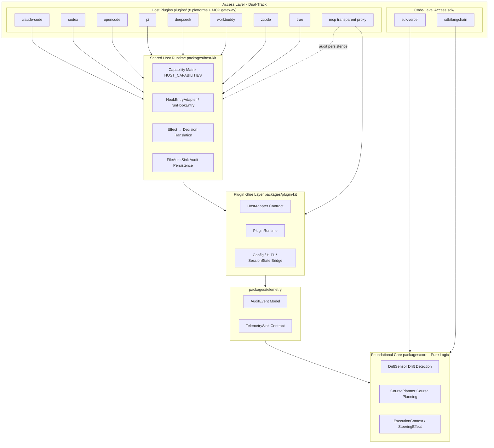
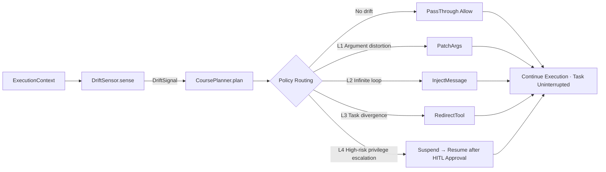

[中文版](./README_zh.md) · English

<div align="center">

```text
 █████╗ ██████╗  ██████╗███████╗
██╔══██╗██╔══██╗██╔════╝██╔════╝
███████║██████╔╝██║     ███████╗
██╔══██║██╔══██╗██║     ╚════██║
██║  ██║██║  ██║╚██████╗███████║
╚═╝  ╚═╝╚═╝  ╚═╝ ╚═════╝╚══════╝
```

# ARCS
**A**gent **R**eal-time **C**ourse **S**teering

**Keep your agents on track, in real time.**  
**始终在轨，实时纠偏，任务不中断。**

*A cross-platform real-time course-steering and dynamic correction engine for agents, built by [Chaos Design](https://github.com).*

[Introduction](#-introduction) • [Core Objectives](#-core-objectives) • [Key Features](#-key-features) • [Architecture](#-architecture) • [Project Structure](#-project-structure) • [Module Breakdown](#-module-breakdown) • [Key Flows](#-key-flows) • [Extension Points and Constraints](#-extension-points-and-constraints) • [Roadmap](#-roadmap) • [Quick Start](#-quick-start) • [Documentation](#-documentation-index) · [中文版](./README_zh.md)

</div>

---

## 📖 Introduction

Whether it is an autonomous agent orchestrated in code or an Agent Harness running in a terminal / IDE (such as OpenAI Codex CLI, DeepSeek Agent Harness, or Claude Code), when executing complex multi-step tasks it is prone to veering off course due to **drift**, context loss, or **infinite loops** — and may even abandon the task halfway.

**ARCS** (**A**gent **R**eal-time **C**ourse **S**teering) is a real-time control plane built in TypeScript that is **framework- and harness-agnostic**. It provides both a **code-level SDK adapter** and a **harness host plugin**, intervening non-invasively between every reasoning decision and tool execution. Through parameter hot-patching, corrective instruction injection, and tool rerouting, it computes a smooth **steering arc** that brings a drifting agent back on track.

> In a nutshell: **correct an agent's direction in real time — without interrupting the task — so it keeps advancing toward its established goal.**

---

## 🎯 Core Objectives

Every design decision in ARCS serves two non-negotiable promises:

1. **Keep the task continuous; never interrupt the current task.** Correction happens inside the execution flow — patching parameters, injecting prompts, redirecting tools — so the task always moves forward and is never forcibly terminated or discarded. Only in high-risk privilege-escalation cases does HITL briefly suspend a single action for approval, then resume execution once approved; the goal is still to continue the task safely, not to abandon it.
2. **Detect drift immediately and correct it, continuously advancing toward the goal.** Detect deviations between the execution direction and the **established goal (Goal)** in real time; the moment a boundary is crossed, correct the course at once to prevent the agent from going further and further in the wrong direction.

---

## ⚡ Key Features

* **🔀 Dual-Track Access (SDK + Harness Plugin)**  
  Can be embedded as middleware into development frameworks such as Vercel AI SDK and LangGraph.js, or attached non-invasively to external harnesses like Codex and DeepSeek via lifecycle hooks or an MCP proxy gateway.
* **🎯 A · Agent State Interception**  
  Built on TypeScript generics and Zod schema contracts, it captures a complete execution snapshot non-invasively between `LLM Thought → Tool Execution`, providing strongly typed evidence for correction.
* **📡 R · Real-time Drift Detection**  
  Combines on-device cosine similarity (Cosine Similarity), sliding-window loop hashing (Loop Hash), and a fast judge model to achieve `< 50ms` low-latency diagnosis — drift is detected the moment it occurs.
* **🧭 C · Course Re-planning**  
  Rejects "hit-the-wall" error aborts. Supports reasoning-branch pruning, tool-degradation routing, and steering prompt injection (Steering Prompt), smoothly correcting course within the execution flow.
* **🕹️ S · Seamless Steering & Override**  
  Automatically hot-patches hallucinated parameters, rewrites high-risk commands in real time, and hands control to a human via `Promise` suspension and human-in-the-loop (HITL) escalation when thresholds are exceeded; the task remains continuous throughout.

---

## 🏗️ Architecture

ARCS adopts a **"microkernel (Core Engine) + plugin glue layer (Plugin Kit) + dual-track access layer (SDK Adapters & Harness Plugins)"** architecture, completely decoupling the correction algorithms from the host runtime.



The dependency graph is a one-way chain: `plugins/* → host-kit → plugin-kit → telemetry → core`; core never perceives the upper layers in reverse. The 8 hook/extension plugins go through `host-kit`'s capability matrix and entry bridge, while the mcp gateway is orchestrated by `plugin-kit` and reuses `host-kit`'s audit persistence. The `AuditEvent` and `TelemetrySink` contracts are defined in `packages/telemetry`; `sdk/*` depends directly on core, bypassing the glue layer. Correction results are ultimately returned to the host to continue execution — this is the technical foundation that makes "uninterrupted tasks" possible.

> For the full architecture and interaction sequence, see [docs/architecture.md](./docs/en/architecture.md).

---

## 📦 Project Structure

The repository is built on `pnpm workspace` + `Turborepo`, with all packages published under the `@chaos-design` namespace. SDKs use standalone `sdk/xxx` folders, while plugins are grouped under `plugins/xxx`:

```text
arcs/
├── packages/
│   ├── core/                  # Foundational core: pure detection/decision, zero host dependencies
│   ├── plugin-kit/            # Plugin glue layer: HostAdapter contract + runtime + bridge
│   ├── host-kit/              # Shared host-plugin runtime: capability matrix + Hook entry bridge + effect translation
│   ├── cli/                   # @chaos-design/arcs-cli: unified CLI (discovery + quick plugin service startup)
│   └── telemetry/             # Trajectory drift curves and correction audit data models/sinks
├── sdk/                       # Code-level access (sdk/xxx, in-process)
│   ├── vercel/                # @chaos-design/arcs-sdk-vercel
│   └── langchain/             # @chaos-design/arcs-sdk-langchain
├── plugins/                   # Host plugins (8 agent platforms + MCP gateway)
│   ├── claude-code/           # Native hooks (17) · L1/L2/L4 ask
│   ├── codex/                 # Native hooks (12) · L1/L2/L4 deny
│   ├── opencode/              # Global plugin + tool middleware · L1/L2/L4 suspend
│   ├── zcode/                 # Native hooks (7) · L2/L4 block
│   ├── workbuddy/             # Native hooks (25) · L2/L4 block
│   ├── pi/                    # Global extension · L2/L4 block
│   ├── deepseek/              # Cordis bundle · L2/L4 event broadcast
│   ├── trae/                  # Project-level hooks · collection and audit only
│   └── mcp/                   # Transparent proxy gateway · L1–L4 (the only one that can rewrite tool names)
├── examples/
│   ├── sdk-vercel-demo/       # Mock model demo: L1 arg patching / L2 circuit breaking
│   └── plugin-mcp-demo/       # Three-process demo: passthrough / L2 circuit breaking / L4 blocking / audit persistence
├── site/                      # Documentation site (Vite + React, embeds docs/*.md at build time; pnpm site:dev / site:build)
├── docs/                      # Architecture and design docs (see index at the end)
├── plans/                     # plan-flow plans
├── LICENSE                    # Apache 2.0
├── turbo.json
└── pnpm-workspace.yaml
```

> For directory responsibilities and boundaries, see [docs/directory-layout.md](./docs/en/directory-layout.md).

---

## 🧩 Module Breakdown

The foundational core and the plugin glue layer are cleanly separated, each with its own responsibilities:

| Concern | `packages/core` (Foundational Core) | `packages/plugin-kit` (Glue Layer) |
| :--- | :--- | :--- |
| Responsibilities | Context modeling, drift detection, course planning, decision generation | HostAdapter contract, runtime orchestration, session state, config/HITL/telemetry bridging |
| Core abstractions | `ExecutionContext`, `DriftSignal`, `SteeringEffect[]`, `DriftSensor`, `CoursePlanner`, `Policy` | `HostAdapter`, `PluginRuntime`, `RawEvent`, `SessionState`, `ConfigSchema`, `HitlTransport` |
| Interface boundary | Takes context in → outputs a serializable ordered list of effects; no host/IO exposure | Receives host events from above, calls core below, then materializes the effect list into actions in order |
| Dependencies | Only `zod`; zero host SDK, zero network, zero filesystem | Depends on core and telemetry; does not import host SDKs (pushed down to plugins) |
| Not responsible for | Event collection, state storage, prompt injection, parameter persistence, approval, telemetry | Detection algorithms and planning strategies |

Concrete plugins (`plugins/*`) only implement `HostAdapter`'s `subscribe / normalize / materialize` and contain no algorithms; SDKs (`sdk/*`) wrap core directly, without taking over host lifecycle or proxying traffic.

> See [core.md](./docs/en/core.md), [plugin-kit.md](./docs/en/plugin-kit.md), [plugins.md](./docs/en/plugins.md), and [sdk.md](./docs/en/sdk.md).

---

## 🔄 Key Flows

The correction loop embodies "no interruption + timely correction": the target of correction is always the drifting action, not the task itself.



| Drift Level | Typical Scenario (common to SDK and Harness) | Effect Type | Steering Effect (task uninterrupted) |
| :--- | :--- | :--- | :--- |
| **L1 · Argument Distortion** | Malformed tool-call JSON, hallucinated path typos | `PatchArgs` | Auto-repairs parameter fields in milliseconds; the host allows it transparently and the task moves forward. |
| **L2 · Terminal Infinite Loop** | Running the same failing command three times in a row | `InjectMessage` | Injects a virtual error hint before the repeated execution to guide a different troubleshooting approach, rather than terminating the task. |
| **L3 · Task Divergence** | Refactoring unrelated directories while fixing a bug | `RedirectTool` + `InjectMessage` | Blocks out-of-scope writes and injects a strong constraint directive, pulling focus back to the established goal (Goal). |
| **L4 · High-Risk Privilege Escalation** | Attempting `rm -rf` or modifying the protected `.env` | `Suspend` | Suspends only the single high-risk action and triggers interactive / webhook approval; execution resumes after approval, so the task continues safely. |

> For the runtime sequence and HITL recovery flow, see [docs/key-flows.md](./docs/en/key-flows.md).

---

## 🔌 Extension Points and Constraints

**Extension points** (extendable without touching core): new detection algorithms (`DriftSensor`), new correction strategies (`CoursePlanner`), new host plugins (`HostAdapter`), new approval channels (`HitlTransport`), new telemetry backends (`TelemetrySink`), new SDK adapters.

**Key constraints**:

1. core must contain no `fs` / `net` / `child_process` imports; asserted by a CI dependency scan.
2. Latency budget: normalize + sense ≤ 35ms, plan ≤ 10ms, materialize ≤ 5ms (total < 50ms); heavy-model judgment runs on an async side channel.
3. `SteeringEffect` (and its ordered list) must be JSON-serializable to support auditing and replay.
4. `Suspend` only suspends a single high-risk action and resumes after approval; rejection / timeout → block + inject an explanation, never escalating to task termination.
5. `plugin-kit` must not import host SDKs; host dependencies are pushed down to `plugins/*`.
6. `sdk/*` must not implement lifecycle hooks or traffic proxying, to avoid overlapping with plugin responsibilities.
7. Fail-open: any detection/planning exception or budget overrun is allowed through and marked degraded; ARCS must never become a source of task interruption.
8. `plan` returns an ordered list of effects, materialized in order; `Suspend` can only appear alone and in the final position.
9. `SessionState` idle timeout (30 minutes by default) must be cleaned up.
10. `TelemetrySink.emit` must not throw exceptions or block the main chain.

> See [extension-points.md](./docs/en/extension-points.md) and [constraints.md](./docs/en/constraints.md).

---

## 🗺️ Roadmap

| Phase | Goal | Definition of Done (DoD) |
| :--- | :--- | :--- |
| **P0** | Core foundation | Type checking passes; algorithm unit-test coverage; fail-open unit tests pass; dependency scan confirms zero host dependencies |
| **P1** | plugin-kit runtime | ReplayHarness replay simulation passes; mock adapter runs the full capture→sense→plan→apply chain in unit tests |
| **P2** | First plugin (MCP) | Real MCP Server attached; L1/L2 correction is observable |
| **P3** | Plugins for 8 agent platforms | ✅ 8 plugins + `host-kit` implemented; mock-host end-to-end fixtures pass; capability matrix and degradation behavior locked by conformance tests (real-host integration testing is pending integrators, see [plugins.md](./docs/en/plugins.md)) |
| **P4** | SDK adapters | ✅ `sdk/vercel` / `sdk/langchain` complete; runnable demos provided in examples/ |
| **P5** | Documentation and telemetry | ✅ README and docs in sync; `pnpm dashboard` generates drift-curve dashboards (terminal + HTML) |

> For phase dependencies and the complete DoD, see [docs/roadmap.md](./docs/en/roadmap.md).

---

## 🚀 Quick Start

### 1. One-Click CLI Startup (Fastest Way to Begin)

Discover and launch any plugin service with a single command, without first learning each host's mounting details:

```bash
# List all plugins (name / host / startup mode / capabilities)
npx @chaos-design/arcs-cli list

# Start the MCP persistent stdio proxy (arguments after -- are forwarded to the plugin verbatim)
npx @chaos-design/arcs-cli start mcp -- \
  --goal "Only fix frontend styles; do not change the backend API" \
  --target "npx -y @modelcontextprotocol/server-filesystem ./src"

# Preview what would run without actually starting
npx @chaos-design/arcs-cli start mcp --dry-run -- --goal "..." --target "..."

# Hook/extension plugins are loaded by the host; the CLI shows how to enable them rather than starting a process
npx @chaos-design/arcs-cli start claude-code
```

`mcp` is the only plugin with a standalone persistent service; the other 8 host plugins are hooks / global extensions invoked from within the host. You can also install globally and use the short command `arcs` (`pnpm add -g @chaos-design/arcs-cli`).

### 2. Code-Level SDK Integration (for Custom Agent Applications)

```bash
pnpm add @chaos-design/arcs-core @chaos-design/arcs-sdk-vercel
```

```typescript
import { generateText } from 'ai';
import { openai } from '@ai-sdk/openai';
import { withArcs } from '@chaos-design/arcs-sdk-vercel';

// Mount the real-time steering middleware
const steeredModel = withArcs(openai('gpt-4o'), {
  goal: 'Refactor the authentication logic under src/auth; do not modify database migration files',
  policy: {
    driftThreshold: 0.75,      // Semantic drift threshold
    maxConsecutiveLoops: 2,    // Max tolerated consecutive errors from the same tool
    enablePatchArgs: true,     // Enable automatic hot-patching of tool arguments (L1)
  },
  onSteer: (event: SteerEvent) => {
    console.warn(`[ARCS Steering] L${event.level} | ${event.reason} | Effects: ${event.effects.map(e => e.type).join(' → ')}`);
  }
});

const { text } = await generateText({
  model: steeredModel,
  tools: myCodingTools,
  maxSteps: 15,
  prompt: 'Start refactoring the authentication module',
});
```

### 3. Documentation Site

```bash
corepack pnpm site:dev      # http://127.0.0.1:5175 browse all docs locally
corepack pnpm site:build    # produce the site/dist static site (embeds docs/*.md at build time, zero external assets)
```

### 4. Drift-Curve Dashboard (P5 · Observing Correction Trajectories)

Audit JSONL from real sessions (`ARCS_AUDIT_FILE` or `<ARCS_HOME>/audit/**`) can be turned directly into a drift-curve dashboard:

```bash
export ARCS_AUDIT_FILE=/tmp/arcs-audit.jsonl     # have the agent / hook plugin persist audit logs
node examples/plugin-mcp-demo/demo.mjs           # run a real three-process demo

corepack pnpm dashboard --file /tmp/arcs-audit.jsonl             # terminal statistics + sparkline
corepack pnpm dashboard --home ~/.arcs --html dashboard.html     # standalone HTML dashboard (inline SVG, zero external assets)
```

The dashboard answers two questions from docs/telemetry.md: **is it converging** (tail severity < head severity) and **is it over-steering** (allow ratio, HITL false positives).

### 5. Harness Host Plugin Integration (for External Agents like Codex / DeepSeek)

For closed or semi-open external harnesses, ARCS offers two non-invasive mounting approaches: **lifecycle hook plugins** and an **MCP transparent proxy**.

#### Option A: Codex / DeepSeek Harness Plugin Mounting

```bash
pnpm add -g @chaos-design/arcs-plugin-codex @chaos-design/arcs-plugin-deepseek
```

```json
// ~/.codex/config.json or deepseek-harness.config.json
{
  "plugins": [
    {
      "name": "@chaos-design/arcs-plugin-codex",
      "enabled": true,
      "options": {
        "driftThreshold": 0.72,
        "autoBreakLoops": true,
        "protectedPaths": ["migrations/**", ".env*"],
        "steeringMode": "inject-hint" // When drifting off goal or looping, inject a steering prompt into the harness
      }
    }
  ]
}
```

#### Option B: Universal MCP Proxy Mode (works with any MCP-enabled harness)

```json
{
  "mcpServers": {
    "steered-filesystem": {
      "command": "npx",
      "args": [
        "-y",
        "@chaos-design/arcs-plugin-mcp",
        "--goal", "Only fix frontend style bugs; do not modify backend API routes",
        "--target", "npx -y @modelcontextprotocol/server-filesystem ./src"
      ]
    }
  }
}
```

---

### 6. Install Host Plugins for Each Platform (8 Agents)

Platform plugins come as native manifests / hooks.json or global extensions, all reusing `host-kit`'s capability matrix and fail-open entry bridge:

```bash
pnpm build:native-plugins

# Trae: merge hooks into the project's .trae/hooks.json (idempotent, preserves unrelated config)
node scripts/install-host-plugins.mjs --client=trae --target=/abs/path/to/workspace

# OpenCode / Pi: copy to the global plugin directory, auto-discovered after restart
node scripts/install-host-plugins.mjs --client=opencode
node scripts/install-host-plugins.mjs --client=pi

# Claude Code / Codex / WorkBuddy / ZCode / DeepSeek: the script prints each platform's CLI install command
node scripts/install-host-plugins.mjs --client=claude-code
```

Correction goals are injected via `--goal` or `ARCS_GOAL`. **The correction levels each platform can actually enforce differ** (for example, hooks generally cannot rewrite tool names, Codex does not support `ask`, and Trae can only audit); see [docs/plugins.md](./docs/en/plugins.md) for the full capability matrix and degradation rules.

## 📚 Documentation Index

For complete design and further reading, see [docs/README.md](./docs/en/README.md):

| Document | Contents |
| :--- | :--- |
| [architecture.md](./docs/en/architecture.md) | Design overview, layered architecture, dependency relationships, and interaction sequence |
| [directory-layout.md](./docs/en/directory-layout.md) | Directory planning and responsibility boundaries |
| [core.md](./docs/en/core.md) | Foundational core responsibilities, abstractions, interface boundaries |
| [plugin-kit.md](./docs/en/plugin-kit.md) | Split boundaries between the plugin glue layer and core |
| [plugins.md](./docs/en/plugins.md) | Adaptation approaches and configuration for each host plugin |
| [sdk.md](./docs/en/sdk.md) | SDK responsibilities, boundaries with plugins, examples |
| [key-flows.md](./docs/en/key-flows.md) | Correction loop, runtime sequence, four-level strategy, HITL recovery, fail-open degradation |
| [telemetry.md](./docs/en/telemetry.md) | Telemetry: AuditEvent model, TelemetrySink contract, drift curves |
| [testing.md](./docs/en/testing.md) | Testing strategy: three test layers and CI boundary guards |
| [extension-points.md](./docs/en/extension-points.md) | Extension points and steps for adding plugins / algorithms |
| [constraints.md](./docs/en/constraints.md) | Constraints (10) and terminology conventions |
| [roadmap.md](./docs/en/roadmap.md) | Phased rollout plan and definition of done |

---

## 🛠️ Local Development & Build

```bash
# Clone the repository
git clone https://github.com/chaos-design/arcs.git
cd arcs

# Install monorepo dependencies
pnpm install

# Build all packages
pnpm build

# Run unit tests and correction simulation
pnpm test
```

Before contributing, please read [CONTRIBUTING.md](./CONTRIBUTING.md) and [CODE_OF_CONDUCT.md](./CODE_OF_CONDUCT.md). Report security vulnerabilities privately as described in [SECURITY.md](./SECURITY.md) — never in a public issue. See [CHANGELOG.md](./CHANGELOG.md) for the release history. Every document is available in both languages; the Chinese entry points are [README_zh.md](./README_zh.md) and [docs/](./docs/README.md).

---

## 📄 License

This project is open-sourced under the [Apache License 2.0](LICENSE). Copyright © 2026 Chaos Design.
