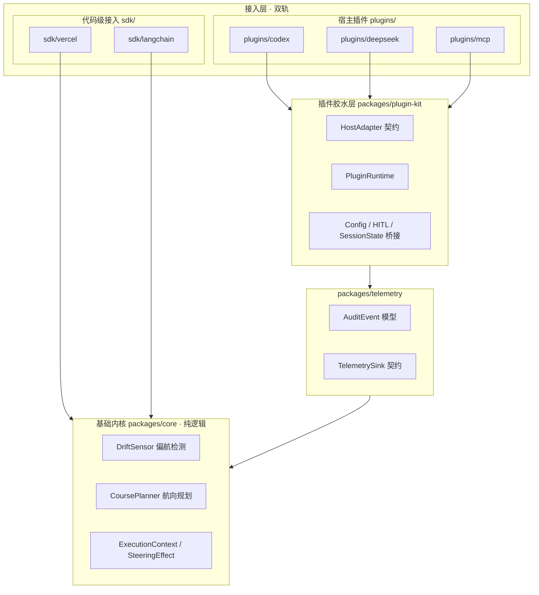
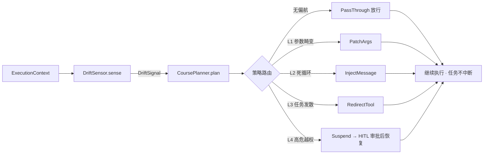

<div align="center">

```text
 █████╗ ██████╗  ██████╗███████╗
██╔══██╗██╔══██╗██╔════╝██╔════╝
███████║██████╔╝██║     ███████╗
██╔══██║██╔══██╗██║     ╚════██║
██║  ██║██║  ██║╚██████╗███████║
╚═╝  ╚═╝╚═╝  ╚═╝ ╚═════╝╚══════╝
```

# ARCS
**A**gent **R**eal-time **C**ourse **S**teering

**Keep your agents on track, in real time.**  
**始终在轨，实时纠偏，任务不中断。**

*由 [Chaos Design](https://github.com) 打造的跨平台 Agent 实时航向操舵与动态纠偏引擎。*

[简介](#-简介) • [核心目标](#-核心目标) • [核心特性](#-核心特性) • [架构设计](#-架构设计) • [工程结构](#-工程结构) • [模块划分](#-模块划分) • [关键流程](#-关键流程) • [扩展与约束](#-扩展点与约束) • [落地计划](#-落地计划) • [快速开始](#-快速开始) • [文档](#-文档索引)

</div>

---

## 📖 简介

无论是通过代码编排的自主智能体，还是运行在终端 / IDE 中的 Agent Harness（如 OpenAI Codex CLI、DeepSeek Agent Harness、Claude Code），在执行多步复杂任务时，都容易因**偏航（Drift）**、上下文失忆或**死循环（Infinite Loop）**而偏离目标，甚至半途而废。

**ARCS**（**A**gent **R**eal-time **C**ourse **S**teering）是一个基于 TypeScript 构建、**框架与宿主双无关（Framework & Harness Agnostic）**的实时控制平面。它同时提供**代码级 SDK 适配器**与**Harness 宿主插件**，在每次推理决策与工具执行之间无侵入介入，通过参数热修复、纠偏指令注入与工具重路由，计算出平滑的**修正弧线（Steering Arc）**，把偏航的 Agent 拉回正轨。

> 一句话概括：**让 Agent 在任务不中断的前提下，实时纠正走向，持续朝既定目标推进。**

---

## 🎯 核心目标

ARCS 的全部设计都服务于两条不可妥协的承诺：

1. **保持任务连续性，不中断当前任务。** 纠偏发生在执行流内部——修复参数、注入提示、重定向工具——任务始终向前推进，不被强制终止或丢弃。仅在高危越权时，才通过 HITL 短暂挂起单个动作等待审批，审批后恢复执行；其目的仍是安全地延续任务，而非放弃任务。
2. **发现偏航立即纠偏，持续朝目标推进。** 实时检测执行方向与**既定目标（Goal）**的偏差，一旦越界立刻修正走向，避免 Agent 在错误方向上越走越远。

---

## ⚡ 核心特性

* **🔀 双轨接入（SDK + Harness 插件）**  
  既可作为 Middleware 嵌入 Vercel AI SDK、LangGraph.js 等开发框架，也可通过生命周期 Hook 或 MCP 代理网关，无侵入挂载到 Codex、DeepSeek 等外部 Harness。
* **🎯 A · 状态拦截（Agent State Interception）**  
  基于 TypeScript 泛型与 Zod Schema 契约，在 `LLM Thought → Tool Execution` 之间无侵入捕获完整执行快照，为纠偏提供强类型依据。
* **📡 R · 实时偏航检测（Real-time Drift Detection）**  
  融合端侧向量相似度（Cosine Similarity）、滑动窗口循环哈希（Loop Hash）与快速裁判模型，实现 `< 50ms` 低延迟诊断，做到偏航即发现。
* **🧭 C · 航向重规划（Course Re-planning）**  
  拒绝“撞墙式”报错中止。支持推理分支剪枝、工具降级路由与纠偏指令注入（Steering Prompt），在执行流内平滑修正走向。
* **🕹️ S · 无感操舵与覆写（Seamless Steering & Override）**  
  自动热修复幻觉参数、实时改写高危命令，并在超阈值时通过 `Promise` 挂起与人工协同接管（HITL）；整个过程中任务保持连续。

---

## 🏗️ 架构设计

ARCS 采用 **“微内核（Core Engine） + 插件胶水层（Plugin Kit） + 双轨接入层（SDK Adapters & Harness Plugins）”** 架构，彻底解耦纠偏算法与宿主运行环境。



依赖关系为单向链：`plugins/* → plugin-kit → telemetry → core`，core 绝不反向感知上层；`AuditEvent` 与 `TelemetrySink` 契约定义在 `packages/telemetry`；`sdk/*` 直接依赖 core，绕过胶水层。纠偏结果最终返回宿主继续执行——这是「任务不中断」得以成立的技术基础。

> 完整架构与交互时序见 [docs/architecture.md](./docs/architecture.md)。

---

## 📦 工程结构

仓库基于 `pnpm workspace` + `Turborepo` 构建，所有包统一发布在 `@chaos-design` 命名空间下。SDK 采用 `sdk/xxx` 独立文件夹，插件集中在 `plugins/xxx`：

```text
arcs/
├── packages/
│   ├── core/                  # 基础内核：纯检测/决策，零宿主依赖
│   ├── plugin-kit/            # 插件胶水层：HostAdapter 契约 + 运行时 + 桥接
│   ├── host-kit/              # 宿主插件共用运行时：能力矩阵 + Hook 入口桥 + 效果翻译
│   └── telemetry/             # 轨迹偏移曲线与纠偏审计数据模型/接收端
├── sdk/                       # 代码级接入（sdk/xxx，进程内）
│   ├── vercel/                # @chaos-design/arcs-sdk-vercel
│   ├── langchain/             # @chaos-design/arcs-sdk-langchain
│   └── README.md
├── plugins/                   # 宿主插件（8 家 Agent 平台 + MCP 网关）
│   ├── claude-code/           # 原生 Hook（17）· L1/L2/L4 ask
│   ├── codex/                 # 原生 Hook（12）· L1/L2/L4 deny
│   ├── opencode/              # 全局插件 + 工具中间件 · L1/L2/L4 挂起
│   ├── zcode/                 # 原生 Hook（7）· L2/L4 阻断
│   ├── workbuddy/             # 原生 Hook（25）· L2/L4 阻断
│   ├── pi/                    # 全局扩展 · L2/L4 阻断
│   ├── deepseek/              # Cordis bundle · L2/L4 事件广播
│   ├── trae/                  # 项目级 hooks · 仅采集与审计
│   └── mcp/                   # 透明代理网关 · L1–L4（唯一可改工具名）
├── examples/
│   ├── sdk-vercel-demo/
│   └── plugin-codex-demo/
├── docs/                      # 架构与设计文档（见文末索引）
├── plans/                     # plan-flow 计划
├── LICENSE                    # Apache 2.0
├── turbo.json
└── pnpm-workspace.yaml
```

> 目录职责与边界见 [docs/directory-layout.md](./docs/directory-layout.md)。

---

## 🧩 模块划分

基础 core 与插件胶水层明确拆分，各司其职：

| 关注点 | `packages/core`（基础内核） | `packages/plugin-kit`（胶水层） |
| :--- | :--- | :--- |
| 职责 | 上下文建模、偏航检测、航向规划、决策生成 | HostAdapter 契约、运行时编排、会话状态、配置/HITL/遥测桥接 |
| 核心抽象 | `ExecutionContext`、`DriftSignal`、`SteeringEffect[]`、`DriftSensor`、`CoursePlanner`、`Policy` | `HostAdapter`、`PluginRuntime`、`RawEvent`、`SessionState`、`ConfigSchema`、`HitlTransport` |
| 接口边界 | 输入上下文 → 输出可序列化的有序效果列表；不暴露宿主/IO | 对上接宿主事件，对下调 core，再把效果列表按序物化为动作 |
| 依赖 | 仅 `zod`；零宿主 SDK、零网络、零文件系统 | 依赖 core 与 telemetry；不 import 宿主 SDK（下沉到 plugins） |
| 不负责 | 事件采集、状态存储、提示注入、参数落地、审批、遥测 | 检测算法与规划策略 |

具体插件（`plugins/*`）只实现 `HostAdapter` 的 `subscribe / normalize / materialize`，不含算法；SDK（`sdk/*`）直接包装 core，不接管宿主生命周期、不做流量代理。

> 详见 [core.md](./docs/core.md)、[plugin-kit.md](./docs/plugin-kit.md)、[plugins.md](./docs/plugins.md)、[sdk.md](./docs/sdk.md)。

---

## 🔄 关键流程

纠偏闭环体现「不中断 + 及时纠偏」：纠偏对象始终是偏航的动作，而非任务本身。



| 偏航等级 | 典型场景（SDK 与 Harness 通用） | 效果类型 | 操舵效果（任务不中断） |
| :--- | :--- | :--- | :--- |
| **L1 · 参数畸变** | 工具调用 JSON 格式错误、路径拼写幻觉 | `PatchArgs` | 毫秒级自动修复参数字段，宿主无感放行，任务继续推进。 |
| **L2 · 终端死循环** | 连续 3 次运行同一报错命令 | `InjectMessage` | 在重复执行前注入虚拟报错提示，引导切换排查思路，而非终止任务。 |
| **L3 · 任务发散** | 修 Bug 时擅自重构无关目录 | `RedirectTool` + `InjectMessage` | 阻断越界写入并注入强约束指令，把焦点拉回既定目标（Goal）。 |
| **L4 · 高危越权** | 试图执行 `rm -rf` 或修改受保护的 `.env` | `Suspend` | 挂起单个高危动作并触发交互 / Webhook 审批，审批后恢复，任务得以安全延续。 |

> 运行时序与 HITL 恢复流程见 [docs/key-flows.md](./docs/key-flows.md)。

---

## 🔌 扩展点与约束

**扩展点**（不改 core 即可扩展）：新增检测算法（`DriftSensor`）、新纠偏策略（`CoursePlanner`）、新宿主插件（`HostAdapter`）、新审批通道（`HitlTransport`）、新遥测后端（`TelemetrySink`）、新 SDK 适配。

**关键约束**：

1. core 不得出现 `fs` / `net` / `child_process` 导入，CI 依赖扫描断言。
2. 延迟预算：normalize + sense ≤ 35ms、plan ≤ 10ms、materialize ≤ 5ms（合计 < 50ms），重模型判断走异步旁路。
3. `SteeringEffect`（及有序列表）必须可 JSON 化，支撑审计与回放。
4. `Suspend` 只挂起单个高危动作，审批后恢复；拒绝/超时 → 阻断 + 注入解释，不得演变为任务终止。
5. `plugin-kit` 不 import 宿主 SDK，宿主依赖下沉到 `plugins/*`。
6. `sdk/*` 不实现生命周期 Hook 或流量代理，避免与插件职责重叠。
7. 失败即降级（fail-open）：检测/规划异常或超预算一律放行并标记 degraded，ARCS 绝不成为任务中断源。
8. `plan` 返回有序效果列表，按序物化；`Suspend` 只能独立出现且位于末位。
9. `SessionState` 空转超时（默认 30 分钟）必须清理。
10. `TelemetrySink.emit` 不得抛异常、不得阻塞主链。

> 详见 [extension-points.md](./docs/extension-points.md) 与 [constraints.md](./docs/constraints.md)。

---

## 🗺️ 落地计划

| 阶段 | 目标 | 完成标准（DoD） |
| :--- | :--- | :--- |
| **P0** | core 地基 | 类型检查通过；算法单测覆盖；失败降级单测通过；依赖扫描确认零宿主依赖 |
| **P1** | plugin-kit 运行时 | ReplayHarness 回放仿真通过；mock adapter 跑通 capture→sense→plan→apply 全链单测 |
| **P2** | 首个插件（MCP） | 真实 MCP Server 挂载，L1/L2 纠偏可观测 |
| **P3** | 8 家 Agent 平台插件 | ✅ 已实现 8 家插件 + `host-kit`；mock 宿主端到端夹具通过，能力矩阵与降级行为由一致性测试锁定（真实宿主实测待集成方执行，见 [plugins.md](./docs/plugins.md)） |
| **P4** | SDK 适配 | 各 demo 跑通，边界约束通过 review |
| **P5** | 文档与遥测 | README 与 docs 同步，Mermaid 图均可渲染 |

> 阶段依赖与完整 DoD 见 [docs/roadmap.md](./docs/roadmap.md)。

---

## 🚀 快速开始

### 1. SDK 代码级集成（适用于自研 Agent 应用）

```bash
pnpm add @chaos-design/arcs-core @chaos-design/arcs-sdk-vercel
```

```typescript
import { generateText } from 'ai';
import { openai } from '@ai-sdk/openai';
import { withArcs } from '@chaos-design/arcs-sdk-vercel';

// 挂载实时操舵中间件
const steeredModel = withArcs(openai('gpt-4o'), {
  goal: '重构 src/auth 目录下的鉴权逻辑，严禁修改数据库迁移文件',
  policy: {
    driftThreshold: 0.75,      // 语义偏移阈值
    maxConsecutiveLoops: 2,    // 同一工具连续报错最大容忍次数
    enablePatchArgs: true,     // 开启工具参数自动热修复（L1）
  },
  onSteer: (event: SteerEvent) => {
    console.warn(`[ARCS 操舵介入] L${event.level} | ${event.reason} | 效果: ${event.effects.map(e => e.type).join(' → ')}`);
  }
});

const { text } = await generateText({
  model: steeredModel,
  tools: myCodingTools,
  maxSteps: 15,
  prompt: '开始重构鉴权模块',
});
```

### 2. Harness 宿主插件集成（适用于 Codex / DeepSeek 等外部 Agent）

针对封闭或半开放的外部 Harness，ARCS 提供 **生命周期 Hook 插件** 与 **MCP 透明代理** 两种无侵入挂载方式。

#### 方式 A：Codex / DeepSeek Harness 插件挂载

```bash
pnpm add -g @chaos-design/arcs-plugin-codex @chaos-design/arcs-plugin-deepseek
```

```json
// ~/.codex/config.json 或 deepseek-harness.config.json
{
  "plugins": [
    {
      "name": "@chaos-design/arcs-plugin-codex",
      "enabled": true,
      "options": {
        "driftThreshold": 0.72,
        "autoBreakLoops": true,
        "protectedPaths": ["migrations/**", ".env*"],
        "steeringMode": "inject-hint" // 偏离目标或死循环时，向 Harness 注入纠偏指令（Steering Prompt）
      }
    }
  ]
}
```

#### 方式 B：通用 MCP 代理模式（适配所有支持 MCP 的 Harness）

```json
{
  "mcpServers": {
    "steered-filesystem": {
      "command": "npx",
      "args": [
        "-y",
        "@chaos-design/arcs-plugin-mcp",
        "--goal", "仅修复前端样式 Bug，禁止修改后端 API 路由",
        "--target", "npx -y @modelcontextprotocol/server-filesystem ./src"
      ]
    }
  }
}
```

---

### 3. 安装各平台宿主插件（8 家 Agent）

平台插件提供原生 manifest / hooks.json 或全局扩展形态，全部复用 `host-kit` 的能力矩阵与 fail-open 入口桥：

```bash
pnpm build:native-plugins

# Trae：把 hooks 合并进项目 .trae/hooks.json（幂等，保留无关配置）
node scripts/install-host-plugins.mjs --client=trae --target=/abs/path/to/workspace

# OpenCode / Pi：复制到全局插件目录，重启后自动发现
node scripts/install-host-plugins.mjs --client=opencode
node scripts/install-host-plugins.mjs --client=pi

# Claude Code / Codex / WorkBuddy / ZCode / DeepSeek：脚本打印各平台 CLI 安装命令
node scripts/install-host-plugins.mjs --client=claude-code
```

纠偏目标通过 `--goal` 或 `ARCS_GOAL` 注入。各平台**实际能落地的纠偏等级不同**（例如 Hook 普遍无法改工具名，Codex 不支持 `ask`，Trae 只能审计），完整能力与降级规则见 [docs/plugins.md](./docs/plugins.md)。

## 📚 文档索引

完整设计与扩展阅读见 [docs/README.md](./docs/README.md)：

| 文档 | 内容 |
| :--- | :--- |
| [architecture.md](./docs/architecture.md) | 设计总纲、分层架构、依赖关系与交互时序 |
| [directory-layout.md](./docs/directory-layout.md) | 目录规划与各目录职责边界 |
| [core.md](./docs/core.md) | 基础内核职责、抽象、接口边界 |
| [plugin-kit.md](./docs/plugin-kit.md) | 插件胶水层与 core 的拆分边界 |
| [plugins.md](./docs/plugins.md) | 各宿主插件的适配方式与配置 |
| [sdk.md](./docs/sdk.md) | SDK 职责、与插件的边界、示例 |
| [key-flows.md](./docs/key-flows.md) | 纠偏闭环、运行时序、四级策略、HITL 恢复、失败降级 |
| [telemetry.md](./docs/telemetry.md) | 遥测：AuditEvent 模型、TelemetrySink 契约、偏移曲线 |
| [testing.md](./docs/testing.md) | 测试策略：三层测试与 CI 边界守护 |
| [extension-points.md](./docs/extension-points.md) | 扩展点与新增插件/算法步骤 |
| [constraints.md](./docs/constraints.md) | 约束说明（10 条）与术语约定 |
| [roadmap.md](./docs/roadmap.md) | 分阶段落地计划与完成标准 |

---

## 🛠️ 本地开发与构建

```bash
# 克隆仓库
git clone https://github.com/chaos-design/arcs.git
cd arcs

# 安装 Monorepo 依赖
pnpm install

# 全量构建所有 packages
pnpm build

# 运行单元测试与纠偏模拟仿真
pnpm test
```

---

## 📄 开源协议

本项目基于 [Apache License 2.0](LICENSE) 协议开源。Copyright © 2026 Chaos Design.
