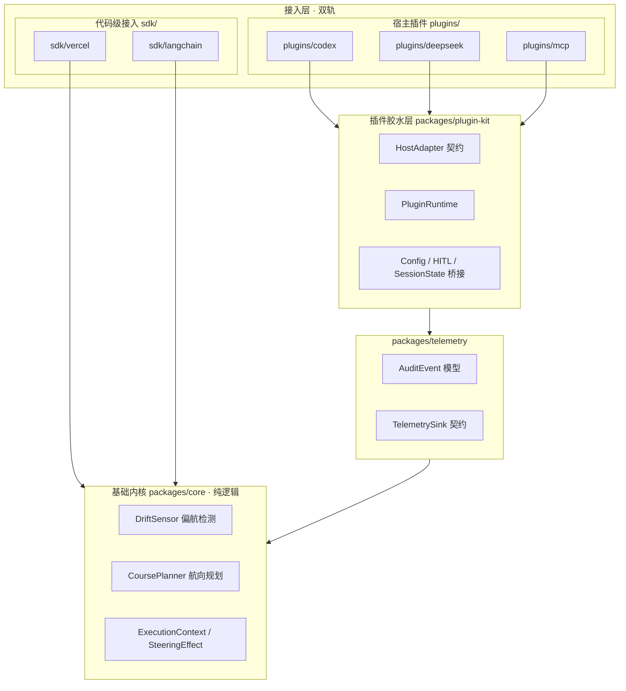
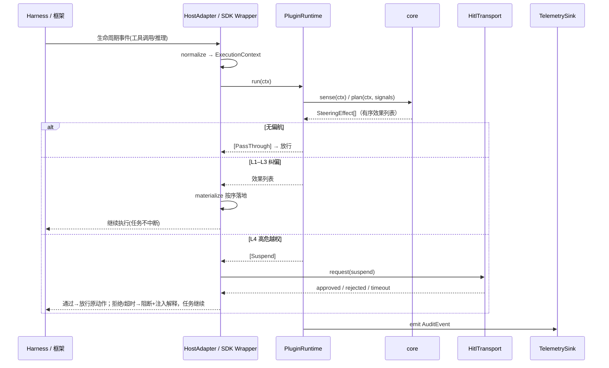

# ARCS 架构设计

## 设计总纲

| 原则 | 含义 |
|---|---|
| core 保持纯逻辑 | 只做「检测 + 决策」，不认识任何宿主 SDK、不做 I/O、不碰进程、不持有状态 |
| 胶水层承接耦合 | 所有宿主相关的事件采集、上下文归一、决策落地、会话状态、配置/审批/遥测桥接收进 `plugin-kit` |
| 插件轻量化 | `plugins/*` 只实现 `HostAdapter`，几乎不含算法，便于快速新增宿主 |
| SDK 走直线 | `sdk/*` 是进程内代码级接入，直接依赖 core，不经过胶水层 |
| 失败即降级（fail-open） | 检测/规划异常或超预算一律放行并标记 degraded——ARCS 绝不成为任务中断源 |

两条不可妥协的核心要求：

1. **保持任务连续性，不中断当前任务。** 纠偏发生在执行流内部——修复参数、注入提示、重定向工具——任务始终向前推进，不被强制终止或丢弃。
2. **发现偏航立即纠偏，持续朝目标推进。** 实时检测执行方向与**既定目标（Goal）**的偏差，一旦越界立刻修正走向，避免 Agent 在错误方向上越走越远。

## 分层架构

## 依赖关系

- 单链：`plugins/* → plugin-kit → telemetry → core`，单向依赖，core 绝不反向感知上层。
- `AuditEvent` 模型与 `TelemetrySink` 契约定义在 `packages/telemetry`，由胶水层消费；telemetry 只依赖 core 的产出类型，不参与决策。
- `sdk/*` 直接依赖 core，绕过胶水层（进程内、强类型、同步可组合）；需要审计时可按需依赖 telemetry 直接上报。

## 模块交互

纠偏结果再返回宿主继续执行——这是「任务不中断」得以成立的技术基础。任何检测/规划异常都会走 fail-open 降级（放行 + degraded 审计），保证 ARCS 自身不阻塞宿主。

## 详细设计

- [目录规划](./directory-layout.md)
- [基础内核 core](./core.md)
- [插件胶水层 plugin-kit](./plugin-kit.md)
- [具体插件 plugins](./plugins.md)
- [SDK 接入](./sdk.md)
- [关键流程](./key-flows.md)
- [扩展点](./extension-points.md)
- [约束说明](./constraints.md)
- [遥测 telemetry](./telemetry.md)
- [测试策略](./testing.md)
- [落地计划](./roadmap.md)
