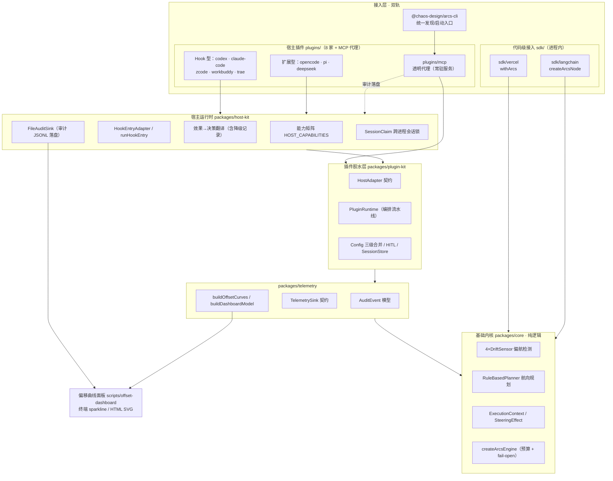
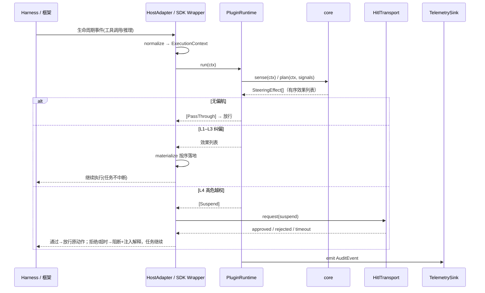
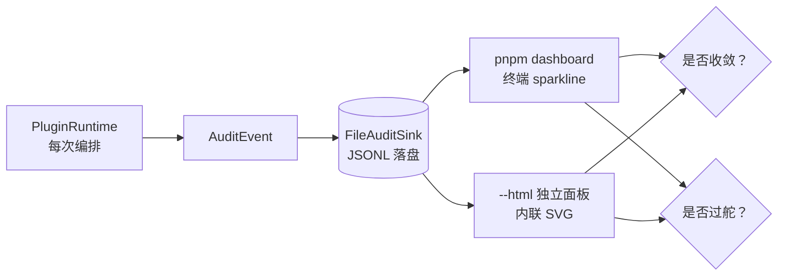

# ARCS 架构设计

## 设计总纲

| 原则 | 含义 |
|---|---|
| core 保持纯逻辑 | 只做「检测 + 决策」，不认识任何宿主 SDK、不做 I/O、不碰进程、不持有状态 |
| 胶水层承接耦合 | 所有宿主相关的事件采集、上下文归一、决策落地、会话状态、配置/审批/遥测桥接收进 `plugin-kit` |
| 宿主运行时共用 | 8 家平台插件共享 `host-kit`（能力矩阵、原生事件映射、效果翻译、Hook 入口桥、审计落盘、会话文件锁） |
| 插件轻量化 | `plugins/*` 只实现宿主差异（hooks 清单、payload 别名、序列化怪癖），几乎不含算法 |
| SDK 走直线 | `sdk/*` 是进程内代码级接入，直接依赖 core，不经过胶水层 |
| 失败即降级（fail-open） | 检测/规划异常或超预算一律放行并标记 degraded——ARCS 绝不成为任务中断源 |

两条不可妥协的核心要求：

1. **保持任务连续性，不中断当前任务。** 纠偏发生在执行流内部——修复参数、注入提示、重定向工具——任务始终向前推进，不被强制终止或丢弃。
2. **发现偏航立即纠偏，持续朝目标推进。** 实时检测执行方向与**既定目标（Goal）**的偏差，一旦越界立刻修正走向，避免 Agent 在错误方向上越走越远。

## 分层架构

## 依赖关系

- 单链：`plugins/* → host-kit → plugin-kit → telemetry → core`，单向依赖，core 绝不反向感知上层。
- `host-kit` 是 packages 层唯一允许 node I/O 的包（审计落盘、会话锁、Hook 入口），由 `scripts/scan-deps.mjs` 红线扫描锁定；每项 node 内建按理由逐条登记白名单。
- `AuditEvent` 模型与 `TelemetrySink` 契约定义在 `packages/telemetry`（纯逻辑零 I/O）；持久化下沉 `host-kit` 的 `FileAuditSink`，聚合复用 `buildOffsetCurves` / `buildDashboardModel`。
- `sdk/*` 直接依赖 core，绕过胶水层（进程内、强类型、同步可组合）；需要审计时可按需依赖 telemetry 直接上报。
- `@chaos-design/arcs-cli` 是发现/启动入口（静态插件注册表 + 依赖注入式实现），不是运行时依赖：它把 mcp 插件作为子进程拉起，Hook 型插件只打印宿主启用方式。

## 模块交互

纠偏结果再返回宿主继续执行——这是「任务不中断」得以成立的技术基础。任何检测/规划异常都会走 fail-open 降级（放行 + degraded 审计），保证 ARCS 自身不阻塞宿主；初始化失败同样降级放行并允许下一事件重试初始化。

## 能力矩阵（Tier A/B/C）

宿主能力差异被 `host-kit` 的 `HOST_CAPABILITIES` 显式建模，效果翻译层按矩阵把 `SteeringEffect` 降级为宿主可表达的决策，**绝不虚假承诺**：

| Tier | 宿主 | L1 补参 | L2 注入 | L3 改道 | L4 挂起/阻断 |
|---|---|---|---|---|---|
| A | codex · claude-code · opencode · mcp | ✅ | ✅ | mcp 独有（改工具名） | A 级原生 hooks 可 ask；mcp 走 HITL 三分支 |
| B | zcode · workbuddy · pi · deepseek | ❌ → 注入 | ✅ | ❌ → 注入 | ❌ 挂起 → block 阻断 |
| C | trae | ❌ | 只读 `additionalContext` | ❌ | 仅采集与审计，不阻断 |

降级不是静默丢失：每次降级在 `HostDecision.degraded` 留痕（如 `suspend→block`、`redirect→inject`），并进入审计事件，可在偏移曲线面板观测。契约由 `verify:contracts`（静态断言 + Codex 官方 schema 行为级校验）与 `host-kit` 一致性测试双重锁定。

## 运行时进程拓扑

| 形态 | 插件 | 拓扑 | 状态边界 |
|---|---|---|---|
| Hook 子进程 | codex / claude-code / zcode / workbuddy / trae | 宿主每个事件 fork 一次 Hook 进程，stdin→stdout 单次往返 | 无常驻状态；会话上下文经 `SessionClaim` 文件锁跨进程续接 |
| 全局扩展 | opencode / pi / deepseek | 插件以扩展/bundle 形态常驻宿主进程内，事件订阅驱动 | 会话 Map（带容量上限）+ claim 锁 |
| 常驻代理 | plugins/mcp | `arcs-plugin-mcp` 作为 stdio JSON-RPC 透明代理，串行队列拦截 `tools/call` | 代理内存态（会话缓冲 + 审计事件），下游 MCP Server 由其 spawn |
| 进程内 SDK | sdk/vercel · sdk/langchain | 包装模型/LangGraph 节点，随宿主应用运行 | 包装实例内滑动历史快照 |

## 稳健性红线（fail-open 的工程化）

fail-open 不是一句口号，而是逐层落实的工程约束（11 号计划加固后全量回归）：

1. **初始化层**：`PluginRuntime.run` 捕获 `ensureInit` 失败 → 降级 PassThrough + degraded 审计，并重置 initPromise 允许下一事件重试；`start()` 订阅链兜底不外抛。
2. **引擎层**：传感器按 CPU 时钟预算独立计时，超预算跳过该传感器（结果带 degraded），整体异常回退 PassThrough。
3. **进程层**：MCP 代理对下游三条管道挂 error 监听（EPIPE 不击穿）、行缓冲 1MB 上限、非法 JSON 行回 JSON-RPC `-32700`、下游不可达时对带 id 请求回 `-32000`——已转发的未决请求在下游退出时统一兑现，绝不悬挂客户端。
4. **遥测层**：`TelemetrySink.emit` 契约规定不得抛异常、同步 < 1ms；emit 失败静默丢弃不影响主链。
5. **资源层**：会话 Map / 注入队列 / 内存 sink 均设容量上限（FIFO 逐出）；会话文件锁超 96 字符的 id 经 sha256 短哈希防截断碰撞。
6. **边界层**：依赖红线扫描（scan-deps）+ 宿主契约护栏（verify-host-contracts）+ GitHub Actions 全量流水线（ci.yml）三道门。

## 观测闭环

面板回答两个问题——**是否收敛**（severity 曲线尾段 < 首段）与**是否过舵**（放行占比、HITL 误报），详见 [telemetry.md](./telemetry.md)。

## 详细设计

- [目录规划](./directory-layout.md)
- [基础内核 core](./core.md)
- [插件胶水层 plugin-kit](./plugin-kit.md)
- [宿主运行时 host-kit](./host-kit.md)
- [具体插件 plugins](./plugins.md)
- [SDK 接入](./sdk.md)
- [关键流程](./key-flows.md)
- [扩展点](./extension-points.md)
- [约束说明](./constraints.md)
- [遥测 telemetry](./telemetry.md)
- [测试策略](./testing.md)
- [落地计划](./roadmap.md)
- [面试题库](./interview.md)
