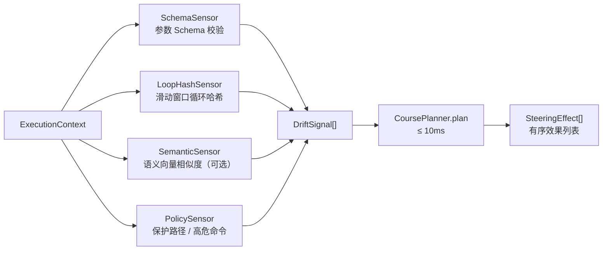

# 基础内核 `packages/core`

基础内核是纯逻辑层：只做「检测 + 决策」，不认识任何宿主、不做 I/O、不碰进程。它是「及时纠偏」能力的算法来源。

## 内部流水线



预算：normalize + sense ≤ 35ms，plan ≤ 10ms，materialize ≤ 5ms（合计 50ms，materialize 属胶水层）。`SemanticSensor` 为可选重传感器，走异步旁路，结果只影响后续事件，不阻塞当前决策。

## 模块职责

- 执行上下文建模（`ExecutionContext`）
- 偏航检测算法：参数 Schema 校验、滑动窗口循环哈希、语义向量相似度、安全策略校验
- 航向规划策略：分支剪枝、工具降级路由、纠偏指令生成
- 输出结构化、可序列化的有序 `SteeringEffect` 列表

## 核心抽象

| 抽象 | 作用 |
|---|---|
| `ExecutionContext` | 归一化执行快照：goal、thought、toolCall、history、budget、policy |
| `DriftSignal` | 偏航信号：kind、severity、score、evidence |
| `SteeringEffect` | 纠偏效果的判别联合；`plan` 输出其**有序列表** |
| `DriftSensor` | 偏航检测接口 `sense(ctx): DriftSignal[]` |
| `CoursePlanner` | 航向规划接口 `plan(ctx, signals): SteeringEffect[]` |
| `Policy` | 阈值、保护路径、操舵模式等约束 |

## 默认传感器与等级映射

每个纠偏等级（L1–L4）对应一类信号与一个内置传感器，`DriftSignal.kind` 枚举与等级一一对应：

| 传感器 | `DriftSignal.kind` | 对应等级 | 检测方式 |
|---|---|---|---|
| `SchemaSensor` | `schema` | L1 参数畸变 | 工具参数 Zod Schema 校验 + 路径拼写启发式 |
| `LoopHashSensor` | `loop` | L2 终端死循环 | 滑动窗口内工具调用指纹哈希 |
| `SemanticSensor` | `semantic` | L3 任务发散 | 端侧向量余弦相似度（可选嵌入，异步旁路） |
| `PolicySensor` | `policy` | L4 高危越权 | 保护路径 / 高危命令规则匹配 |

## 接口边界（设计签名）

```typescript
interface ToolCall {
  id: string;
  name: string;
  args: Record<string, unknown>;
}

interface Snapshot {
  thought: string;
  toolCall: ToolCall;
  ts: number;
  outcome?: 'ok' | 'error';   // 工具执行结果，供循环检测
}

interface Budget {
  stepsUsed: number;
  stepsMax: number;
  elapsedMs: number;
}

interface ExecutionContext {
  goal: string;
  thought: string;
  toolCall: ToolCall;
  history: Snapshot[];        // 由 plugin-kit 的 SessionState 注入
  budget: Budget;
  policy: Policy;
}

interface DriftSignal {
  kind: 'schema' | 'loop' | 'semantic' | 'policy';
  severity: number;           // 0–1，越界程度
  score: number;              // 原始得分 / 证据数值
  evidence: string;
}

type SteeringEffect =
  | { type: 'PassThrough' }
  | { type: 'PatchArgs'; patch: Record<string, unknown> }   // patch = 修复后的完整参数（整体替换语义）
  | { type: 'InjectMessage'; role: 'system' | 'tool'; content: string }
  | { type: 'RedirectTool'; target: string }   // 语义 = 阻断原调用并改道 target
  | { type: 'Suspend'; reason: string };

interface DriftSensor   { sense(ctx: ExecutionContext): DriftSignal[] }
interface CoursePlanner { plan(ctx: ExecutionContext, s: DriftSignal[]): SteeringEffect[] }
```

### 效果列表约定

- `plan` 返回**有序列表**，运行时按序物化。组合语义用于表达「阻断 + 注入」类复合纠偏：L2 = `[InjectMessage]`，L3 = `[RedirectTool, InjectMessage]`。
- `Suspend` 只能独立出现且位于末位，不得与其他效果组合（单一挂起点，避免部分物化状态）。

## 性能预算分解

| 阶段 | 预算 | 超预算行为 |
|---|---|---|
| normalize + sense | ≤ 35ms | 放弃未完成的可选传感器，用已产出信号继续 |
| plan | ≤ 10ms | 退回 `[PassThrough]`，标记 degraded |
| materialize（胶水层落地） | ≤ 5ms | 放行原始调用 + 告警 |

`SemanticSensor` 等重传感器可注册为**异步旁路**：当前事件不等待其结果，产出的信号进入下一事件的检测窗口，因此总预算不被重模型判断挤占。

## 降级语义（fail-open）

core 被插入执行链路，自身绝不能成为任务中断源：

- 单个传感器抛出异常或超时 → **跳过该传感器**，其余照常；
- sense + plan 整体异常或超预算 → 输出 `[PassThrough]` 并置 **degraded** 标记（由胶水层上报审计事件）；
- 异常一律转为「降级结果 + 原因」向上传递，core 不向宿主抛出未处理异常。

## 依赖关系与交互

- **依赖**：仅 `zod`（Schema 校验）；零宿主 SDK、零网络、零文件系统。
- **被依赖**：`plugin-kit` 与 `sdk/*` 调用 `sense/plan`；`telemetry` 消费审计事件（`AuditEvent` 契约定义于 telemetry 包）。
- **交互契约**：输入归一化上下文，输出可序列化的有序决策列表；不暴露任何宿主/IO 接口。

## 明确不负责

- 事件采集、提示注入、参数改写的「落地」动作（属于 plugin-kit / plugins）
- 审批交互、遥测上报与会话状态存储（属于 plugin-kit 的桥接与 SessionState）
- 任何宿主 SDK 的 import

> core 的纯度是整套架构可移植的前提，约束见 [constraints.md](./constraints.md)；运行时如何消费效果列表见 [plugin-kit.md](./plugin-kit.md)。
