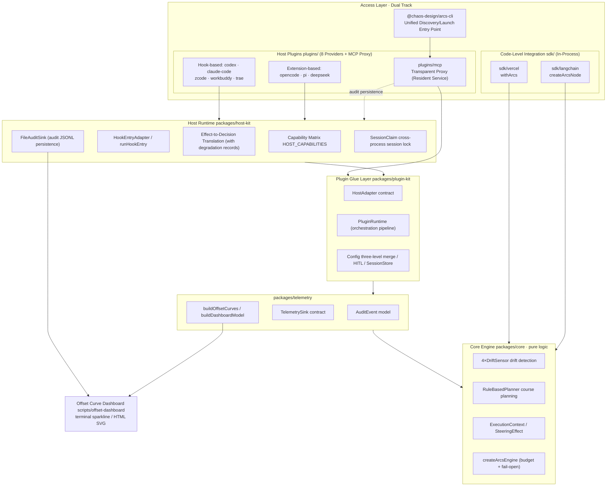
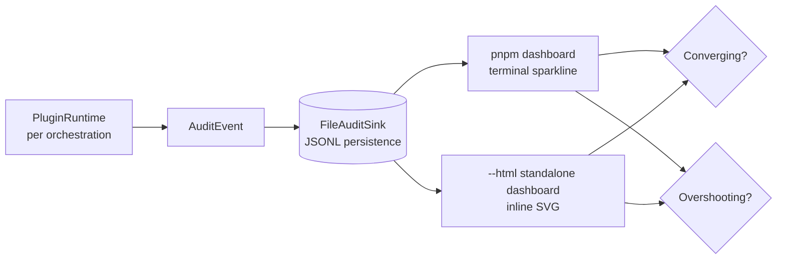

[中文版](../architecture.md) · English

# ARCS Architecture Design

## General Design Principles

| Principle | Meaning |
|---|---|
| core stays pure logic | Performs only "detection + decision": it knows no host SDK, does no I/O, touches no processes, and holds no state |
| The glue layer absorbs coupling | All host-related concerns—event collection, context normalization, decision materialization, session state, and configuration/approval/telemetry bridges—are consolidated into `plugin-kit` |
| Shared host runtime | All 8 platform plugins share `host-kit` (capability matrix, native event mapping, effect translation, Hook entry bridge, audit persistence, session file locks) |
| Lightweight plugins | `plugins/*` implement only host-specific differences (hooks manifests, payload aliases, serialization quirks) and contain almost no algorithms |
| SDKs take a direct path | `sdk/*` are in-process, code-level integrations that depend directly on core and bypass the glue layer |
| Fail open on failure | Any detection/planning exception or budget overrun is passed through and marked degraded—ARCS must never become a source of task interruption |

Two non-negotiable core requirements:

1. **Maintain task continuity; never interrupt the current task.** Correction happens within the execution flow—patching arguments, injecting prompts, redirecting tools—so the task always moves forward and is never forcibly terminated or discarded.
2. **Correct drift immediately upon detection and keep advancing toward the goal.** Detect deviations between the execution direction and the established **Goal** in real time; as soon as a boundary is crossed, correct the course immediately so the Agent does not drift further in the wrong direction.

## Layered Architecture



## Dependency Relationships

- Single chain: `plugins/* → host-kit → plugin-kit → telemetry → core`, with unidirectional dependencies; core never perceives upper layers in reverse.
- `host-kit` is the only package in the packages layer permitted to perform node I/O (audit persistence, session locks, Hook entry points), locked down by the `scripts/scan-deps.mjs` red-line scan; each node built-in is whitelisted individually with a justification.
- The `AuditEvent` model and `TelemetrySink` contract are defined in `packages/telemetry` (pure logic, zero I/O); persistence is delegated down to `host-kit`'s `FileAuditSink`, and aggregation reuses `buildOffsetCurves` / `buildDashboardModel`.
- `sdk/*` depend directly on core, bypassing the glue layer (in-process, strongly typed, synchronously composable); when auditing is needed, they can optionally depend on telemetry to report directly.
- `@chaos-design/arcs-cli` is a discovery/launch entry point (static plugin registry + dependency-injected implementations), not a runtime dependency: it spawns the mcp plugin as a child process, while Hook-based plugins only print how to enable them in the host.

## Module Interaction

```mermaid
sequenceDiagram
  participant H as Harness / Framework
  participant A as HostAdapter / SDK Wrapper
  participant RT as PluginRuntime
  participant K as core
  participant HL as HitlTransport
  participant T as TelemetrySink
  H->>A: Lifecycle events (tool call / reasoning)
  A->>A: normalize → ExecutionContext
  A->>RT: run(ctx)
  RT->>K: sense(ctx) / plan(ctx, signals)
  K-->>RT: SteeringEffect[] (ordered effect list)
  alt No drift
    RT-->>A: [PassThrough] → pass through
  else L1–L3 correction
    RT-->>A: effect list
    A->>A: materialize in order
    A-->>H: continue execution (task uninterrupted)
  else L4 high-risk privilege escalation
    RT-->>A: [Suspend]
    A->>HL: request(suspend)
    HL-->>A: approved / rejected / timeout
    A-->>H: approved → pass through original action; rejected/timeout → block + inject explanation, task continues
  end
  RT->>T: emit AuditEvent
```

The correction result is returned to the host to continue execution—this is the technical foundation that makes "task uninterrupted" possible. Any detection/planning exception goes through fail-open degradation (pass through + degraded audit), ensuring ARCS itself never blocks the host; initialization failures likewise degrade to pass-through and allow the next event to retry initialization.

## Capability Matrix (Tier A/B/C)

Host capability differences are explicitly modeled by `host-kit`'s `HOST_CAPABILITIES`; the effect translation layer degrades `SteeringEffect` into decisions the host can express according to the matrix, **never making false promises**:

| Tier | Host | L1 Argument Patch | L2 Injection | L3 Redirection | L4 Suspend/Block |
|---|---|---|---|---|---|
| A | codex · claude-code · opencode · mcp | ✅ | ✅ | mcp-only (change tool name) | Tier A native hooks can ask; mcp uses the three-branch HITL |
| B | zcode · workbuddy · pi · deepseek | ❌ → injection | ✅ | ❌ → injection | ❌ suspend → block |
| C | trae | ❌ | read-only `additionalContext` | ❌ | Collection and audit only, no blocking |

Degradation is not silent loss: every degradation leaves a trace in `HostDecision.degraded` (e.g., `suspend→block`, `redirect→inject`) and enters an audit event, observable on the offset curve dashboard. The contract is double-locked by `verify:contracts` (static assertions + behavioral validation against Codex's official schema) and `host-kit` consistency tests.

## Runtime Process Topology

| Form | Plugins | Topology | State Boundary |
|---|---|---|---|
| Hook child process | codex / claude-code / zcode / workbuddy / trae | The host forks a Hook process per event, with a single stdin→stdout round trip | No resident state; session context is resumed across processes via the `SessionClaim` file lock |
| Global extension | opencode / pi / deepseek | The plugin resides in the host process as an extension/bundle, driven by event subscriptions | Session Map (with capacity limit) + claim lock |
| Resident proxy | plugins/mcp | `arcs-plugin-mcp` acts as a stdio JSON-RPC transparent proxy, intercepting `tools/call` via a serial queue | Proxy in-memory state (session buffer + audit events); downstream MCP Servers are spawned by it |
| In-process SDK | sdk/vercel · sdk/langchain | Wraps models/LangGraph nodes and runs with the host application | Sliding history snapshot within the wrapper instance |

## Robustness Red Lines (Engineering fail-open)

fail-open is not a slogan but an engineering constraint implemented layer by layer (fully regressed after the hardening in Plan #11):

1. **Initialization layer**: `PluginRuntime.run` catches `ensureInit` failures → degrades to PassThrough + degraded audit, and resets `initPromise` to allow the next event to retry; the `start()` subscription chain has a fallback that does not throw.
2. **Engine layer**: sensors are timed independently against a CPU clock budget; over-budget sensors are skipped (result marked degraded), and overall exceptions fall back to PassThrough.
3. **Process layer**: the MCP proxy attaches error listeners to all three downstream pipes (so EPIPE cannot break through), caps line buffering at 1MB, returns JSON-RPC `-32700` for invalid JSON lines, and returns `-32000` for id-bearing requests when the downstream is unreachable—already-forwarded pending requests are all settled when the downstream exits, never leaving the client hanging.
4. **Telemetry layer**: the `TelemetrySink.emit` contract mandates no exceptions and synchronous < 1ms; emit failures are silently dropped without affecting the main chain.
5. **Resource layer**: session Map / injection queue / in-memory sink all have capacity limits (FIFO eviction); session file lock ids longer than 96 characters use a short sha256 hash to prevent truncation collisions.
6. **Boundary layer**: three gates—dependency red-line scanning (scan-deps) + host contract guardrails (verify-host-contracts) + the full GitHub Actions pipeline (ci.yml).

## Observability Feedback Loop



The dashboard answers two questions—whether it is **converging** (the tail of the severity curve < its head) and whether it is **overshooting** (pass-through ratio, HITL false positives); see [telemetry.md](./telemetry.md) for details.

## Detailed Design

- [Directory Layout](./directory-layout.md)
- [Core Engine core](./core.md)
- [Plugin Glue Layer plugin-kit](./plugin-kit.md)
- [Host Runtime host-kit](./host-kit.md)
- [Concrete Plugins plugins](./plugins.md)
- [SDK Integration](./sdk.md)
- [Key Flows](./key-flows.md)
- [Extension Points](./extension-points.md)
- [Constraints](./constraints.md)
- [Telemetry telemetry](./telemetry.md)
- [Testing Strategy](./testing.md)
- [Rollout Plan](./roadmap.md)
- [Interview Question Bank](./interview.md)
