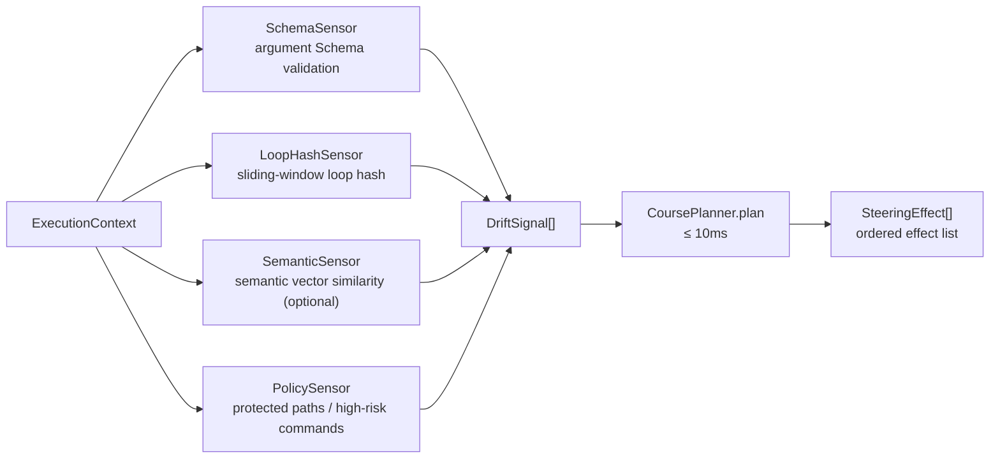

[中文版](../core.md) · English

# Core Engine `packages/core`

The core engine is a pure logic layer: it performs only "detection + decision," knows no host, does no I/O, and touches no processes. It is the algorithmic source of the "timely correction" capability.

## Internal Pipeline



Budget: normalize + sense ≤ 35ms, plan ≤ 10ms, materialize ≤ 5ms (50ms total; materialize belongs to the glue layer). `SemanticSensor` is an optional heavy sensor running on an asynchronous side channel; its result affects only subsequent events and does not block the current decision.

## Module Responsibilities

- Execution context modeling (`ExecutionContext`)
- Drift detection algorithms: argument Schema validation, sliding-window loop hashing, semantic vector similarity, security policy validation
- Course planning strategies: branch pruning, tool degradation routing, correction instruction generation
- Output a structured, serializable, ordered `SteeringEffect` list

## Core Abstractions

| Abstraction | Role |
|---|---|
| `ExecutionContext` | Normalized execution snapshot: goal, thought, toolCall, history, budget, policy |
| `DriftSignal` | Drift signal: kind, severity, score, evidence |
| `SteeringEffect` | Discriminated union of correction effects; `plan` outputs an **ordered list** of them |
| `DriftSensor` | Drift detection interface `sense(ctx): DriftSignal[]` |
| `CoursePlanner` | Course planning interface `plan(ctx, signals): SteeringEffect[]` |
| `Policy` | Constraints such as thresholds, protected paths, and steering modes |

## Default Sensors and Level Mapping

Each correction level (L1–L4) corresponds to one signal kind and one built-in sensor; the `DriftSignal.kind` enum maps one-to-one to the levels:

| Sensor | `DriftSignal.kind` | Corresponding Level | Detection Method |
|---|---|---|---|
| `SchemaSensor` | `schema` | L1 argument distortion | Zod Schema validation of tool arguments + path spelling heuristics |
| `LoopHashSensor` | `loop` | L2 terminal infinite loop | Fingerprint hashing of tool calls within a sliding window |
| `SemanticSensor` | `semantic` | L3 task divergence | On-device vector cosine similarity (optional embedding, asynchronous side channel) |
| `PolicySensor` | `policy` | L4 high-risk privilege escalation | Protected path / high-risk command rule matching |

## Interface Boundaries (Design Signatures)

```typescript
interface ToolCall {
  id: string;
  name: string;
  args: Record<string, unknown>;
}

interface Snapshot {
  thought: string;
  toolCall: ToolCall;
  ts: number;
  outcome?: 'ok' | 'error';   // Tool execution result, for loop detection
}

interface Budget {
  stepsUsed: number;
  stepsMax: number;
  elapsedMs: number;
}

interface ExecutionContext {
  goal: string;
  thought: string;
  toolCall: ToolCall;
  history: Snapshot[];        // Injected by plugin-kit's SessionState
  budget: Budget;
  policy: Policy;
}

interface DriftSignal {
  kind: 'schema' | 'loop' | 'semantic' | 'policy';
  severity: number;           // 0–1, degree of boundary violation
  score: number;              // Raw score / evidence value
  evidence: string;
}

type SteeringEffect =
  | { type: 'PassThrough' }
  | { type: 'PatchArgs'; patch: Record<string, unknown> }   // patch = the complete repaired arguments (whole-replacement semantics)
  | { type: 'InjectMessage'; role: 'system' | 'tool'; content: string }
  | { type: 'RedirectTool'; target: string }   // Semantics = block the original call and redirect to target
  | { type: 'Suspend'; reason: string };

interface DriftSensor   { sense(ctx: ExecutionContext): DriftSignal[] }
interface CoursePlanner { plan(ctx: ExecutionContext, s: DriftSignal[]): SteeringEffect[] }
```

### Effect List Conventions

- `plan` returns an **ordered list**, which the runtime materializes in order. The composition semantics express compound corrections such as **"block + inject"**: L2 = `[InjectMessage]`, L3 = `[RedirectTool, InjectMessage]`.
- `Suspend` must appear alone and in the final position; it cannot be combined with other effects (a single suspension point avoids partially materialized state).

## Performance Budget Breakdown

| Stage | Budget | Over-Budget Behavior |
|---|---|---|
| normalize + sense | ≤ 35ms | Abandon unfinished optional sensors and continue with the signals already produced |
| plan | ≤ 10ms | Fall back to `[PassThrough]` and mark degraded |
| materialize (glue-layer materialization) | ≤ 5ms | Pass through the original call + raise an alert |

Heavy sensors such as `SemanticSensor` can be registered as an **asynchronous side channel**: the current event does not wait for their results, and the signals produced enter the next event's detection window, so the total budget is not consumed by heavy model inference.

## Degradation Semantics (fail-open)

core is inserted into the execution chain and must never itself become a source of task interruption:

- A single sensor throws or times out → **skip that sensor** and proceed with the rest as normal;
- `sense + plan` as a whole throws or exceeds budget → output `[PassThrough]` and set the **degraded** flag (the glue layer reports an audit event);
- All exceptions are converted into a **"degraded result + reason"** and propagated upward; core never throws unhandled exceptions to the host.

## Dependencies and Interaction

- **Dependencies**: only `zod` (Schema validation); zero host SDKs, zero network, zero filesystem.
- **Depended on by**: `plugin-kit` and `sdk/*` call `sense/plan`; `telemetry` consumes audit events (the `AuditEvent` contract is defined in the telemetry package).
- **Interaction contract**: takes a normalized context as input and outputs a serializable, ordered decision list; exposes no host/IO interfaces.

## Explicitly Out of Scope

- The "materialization" actions of event collection, prompt injection, and argument rewriting (belong to plugin-kit / plugins)
- Approval interaction, telemetry reporting, and session state storage (belong to plugin-kit's bridges and SessionState)
- Importing any host SDK

> core's purity is the prerequisite for the portability of the entire architecture; see [constraints.md](./constraints.md) for the constraints, and [plugin-kit.md](./plugin-kit.md) for how the runtime consumes the effect list.
