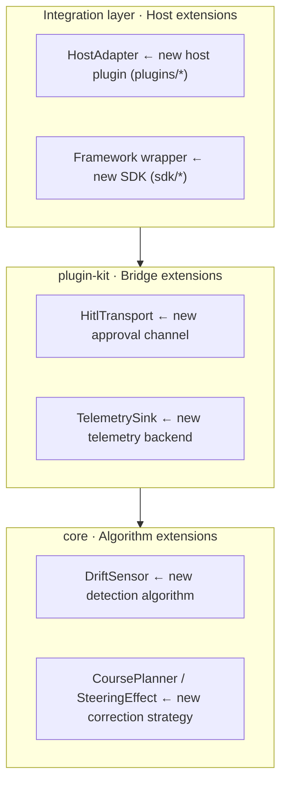

[中文版](../extension-points.md) · English

# Extension Points

ARCS reserves stable extension points at every layer, so extensions do not require changes to core.

## Extension-point overview

## Extension-point inventory

| Extension point | Location | How to extend | Typical scenario | Touches core? |
|---|---|---|---|---|
| New detection algorithm | core | Implement `DriftSensor` and register it | Custom similarity, domain rules | New implementation, no core change |
| New correction strategy | core | Extend `SteeringEffect` + `CoursePlanner` | Add a degradation routing strategy | Requires extending the discriminated union |
| New host plugin | plugins | Implement `HostAdapter` | Cursor, Windsurf, etc. | No |
| Approval channel | plugin-kit | Implement `HitlTransport` | Enterprise IM, Webhook | No |
| Telemetry backend | telemetry | Implement `TelemetrySink` | OpenTelemetry, custom dashboard | No |
| New SDK adaptation | sdk | Wrap core with a framework-native wrapper | New Agent framework | No |

## Extension-contract considerations

- **Approval channel**: the implementation **must have timeout semantics** (default 120s; a timeout counts as rejection) and must not suspend the execution flow indefinitely; the returned `HitlDecision` must explicitly carry the `timeout` field. See [key-flows.md](./key-flows.md) for the suspend–resume flow.
- **Telemetry backend**: `emit` must not throw and must take < 1ms on the synchronous path; otherwise, buffer internally and flush asynchronously; see [telemetry.md](./telemetry.md) for the contract.
- **New detection algorithm**: remain a pure function, synchronous, and with no I/O; do not change the `ExecutionContext` contract; route heavy-model judgments through the async bypass (results enter the next event window).
- **New correction strategy**: when extending the discriminated union, keep it JSON-serializable (constraint #3) and update the serialization unit tests and replay simulation cases accordingly.

## Steps to add a host plugin

1. Create a new package under `plugins/<host>/`, depending on `plugin-kit` and the host SDK.
2. Implement `HostAdapter`'s `subscribe` / `normalize` / `materialize`.
3. Reuse `PluginRuntime` to orchestrate the pipeline; do not reimplement detection and planning, state management, or the fail-open fallback.
4. Expose host configuration items (thresholds, protected paths, steering mode) via `ConfigSchema`.
5. Add end-to-end tests: verify the "task not interrupted" behavior of L1–L4 in the real host (see [testing.md](./testing.md)).

## Steps to add a detection algorithm

1. Implement `DriftSensor.sense(ctx): DriftSignal[]`.
2. Keep it a pure function, synchronous, and with no I/O.
3. Register it in core and add unit tests (including the degrade-by-skipping behavior on exceptions); do not change the `ExecutionContext` contract.
