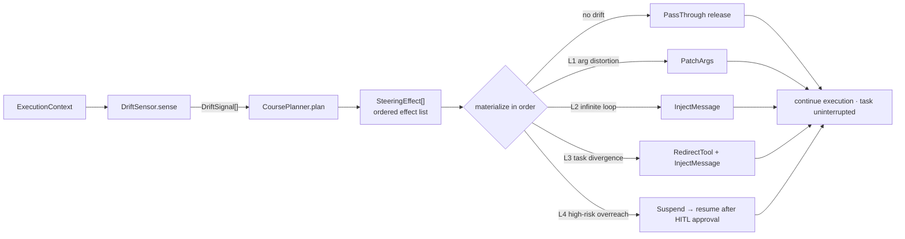
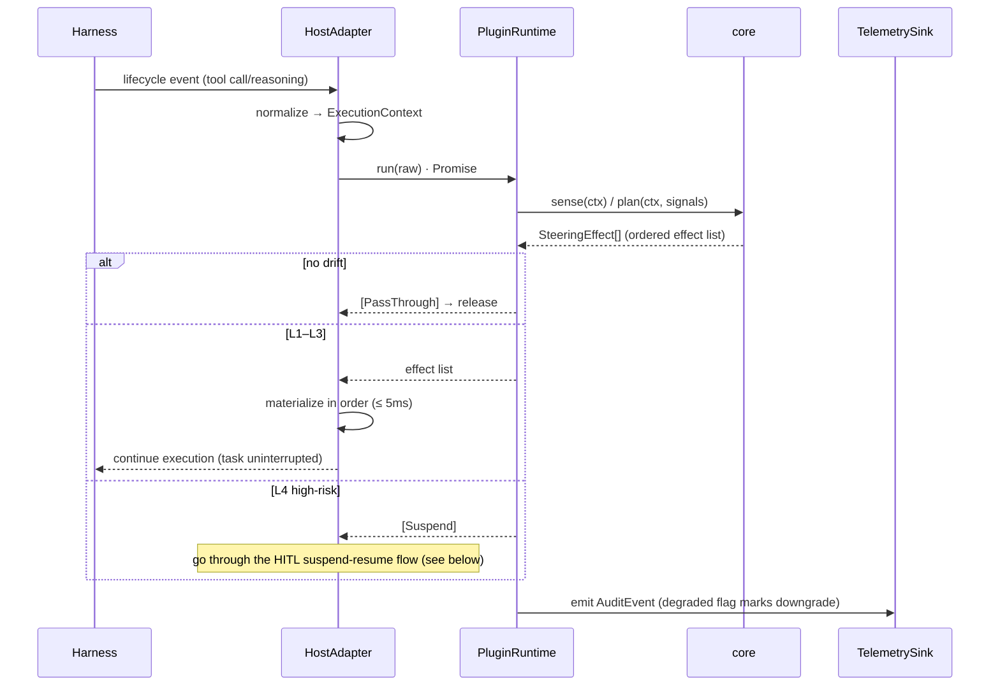
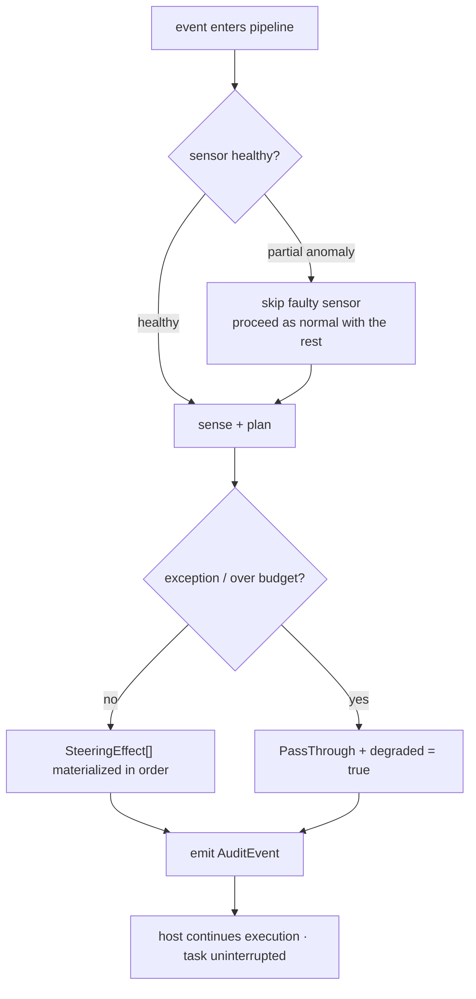

[中文版](../key-flows.md) · English

# Key Flows

## Main Correction Loop

This embodies "no interruption + timely correction": the target of correction is always the drifting action, not the task itself. `plan` outputs an **ordered effect list**, which the runtime materializes in order, enabling compound corrections such as "block + inject".



## Plugin Runtime Sequence



## Four-Level Correction Strategy

| Drift Level | Typical Scenario (common to SDK and Harness) | Effect Type | Steering Effect (task uninterrupted) |
| :--- | :--- | :--- | :--- |
| **L1 · Argument Distortion** | Malformed tool-call JSON, hallucinated path spelling | `PatchArgs` | Repairs argument fields automatically in milliseconds; the host passes it through unaware and the task keeps advancing. |
| **L2 · Terminal Infinite Loop** | Running the same erroring command three times in a row | `InjectMessage` | Injects a virtual error hint before the repeated execution to guide a change of troubleshooting approach, rather than terminating the task. |
| **L3 · Task Divergence** | Refactoring unrelated directories while fixing a bug | `RedirectTool` + `InjectMessage` | Blocks out-of-bounds writes and injects strong constraint instructions, pulling focus back to the established Goal. |
| **L4 · High-Risk Overreach** | Attempting `rm -rf` or modifying a protected `.env` | `Suspend` | Suspends the single high-risk action and triggers interactive / Webhook approval; it resumes after approval so the task continues safely. |

## HITL Suspend-Resume Flow

L4 is the only "pause" scenario, but what is paused is a single action, not the task: after approval it resumes from the suspension point; on rejection or timeout the action is blocked and an explanation is injected, while the task continues advancing toward the goal.

```mermaid
sequenceDiagram
  participant A as HostAdapter
  participant HL as HitlTransport
  participant H as Harness
  A->>HL: request(Suspend, ctx)
  alt approved
    HL-->>A: { approved: true }
    A->>H: release original action, continue from suspension point
  else rejected
    HL-->>A: { approved: false, timeout: false }
    A->>H: block original action; InjectMessage with rejection reason and reroute hint
  else timeout (default 120s)
    HL-->>A: { approved: false, timeout: true }
    A->>H: same as rejection; warning audit event
  end
  Note over H: task continues toward the established goal, never terminated
```

## Failure Degradation Path (fail-open)

No exception in the detection/planning pipeline itself may interrupt the host task — degrade to pass-through and leave an audit trace:



Degradation is layered: a single-sensor anomaly → skip; overall anomaly / over budget → PassThrough + degraded; a materialize anomaly → release the original call + warning. For contract details, see the "Failure Fallback" section in [plugin-kit.md](./plugin-kit.md).
