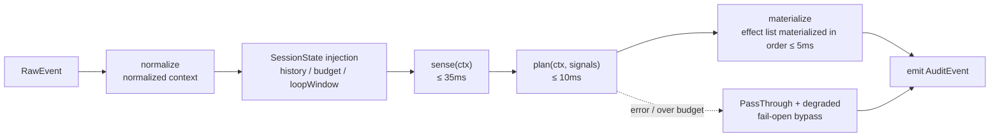

[中文版](../plugin-kit.md) · English

# Plugin Glue Layer `packages/plugin-kit`

The plugin glue layer absorbs all host coupling: it translates host lifecycle events into contexts that core can understand, then materializes core's decisions into host actions. It is the shared foundation for "keeping core's critical implementation plugin-focused" — every plugin is built on top of it, so repeated logic is written only once.

## Orchestration Pipeline



## Module Responsibilities

- Defines the `HostAdapter` contract (event collection, context normalization, decision materialization)
- `PluginRuntime` orchestrates the pipeline: collect → normalize → state injection → detect → plan → materialize → report
- Session state management (`SessionState`): loop window, history ring buffer, budget counting
- Configuration loading and validation (Zod Schema), configuration priority arbitration
- HITL approval channel bridging, telemetry reporting bridging, fail-open degradation fallback

## Core Abstractions

| Abstraction | Role |
|---|---|
| `HostAdapter` | Host adapter contract: subscribe / normalize / materialize |
| `PluginRuntime` | Runtime orchestrator `run(raw: RawEvent): Promise<SteeringOutcome>` |
| `RawEvent` | Raw host event: host, type, sessionId, timestamp, payload |
| `SteeringOutcome` | Result of a single orchestration run: effects, signals, latencyMs, degraded |
| `SessionState` | Session state bucketed by sessionKey (loop window / history / budget) |
| `ConfigSchema` | Plugin configuration schema (thresholds, protected paths, steering mode) |
| `HitlTransport` | Approval channel `request(e, ctx): Promise<HitlDecision>` |
| `TelemetrySink` | Telemetry receiver contract, **defined in packages/telemetry**, depended on and invoked by the kit |
| `EffectMaterializer` | Maps a `SteeringEffect` list to host actions in order |

## Interface Boundaries (Design Signatures)

```typescript
interface RawEvent {
  host: string;                // 'chatgpt' | 'deepseek' | 'claude-code' | 'mcp' | ...
  type: 'tool-call' | 'thought' | 'command';
  sessionId: string;           // host session identifier, used as sessionKey
  timestamp: number;
  payload: unknown;            // native host event data
}

interface SteeringOutcome {
  effects: SteeringEffect[];   // ordered effect list output by plan
  signals: DriftSignal[];
  latencyMs: number;           // time spent in normalize + sense + plan
  degraded: boolean;           // set if any stage degrades
}

interface HostAdapter {
  subscribe(notify: (raw: RawEvent) => void): void;
  normalize(raw: RawEvent): ExecutionContext;
  materialize(effect: SteeringEffect, ctx: ExecutionContext): Promise<MaterializeResult>;
  setup?(handles: KitHandles): void | Promise<void>;  // inject hitl and the final config during Runtime initialization
}

interface KitHandles { hitl: HitlTransport; config: ArcsConfig }

type MaterializeResult =
  | { applied: true }                       // effect materialized / original action allowed through
  | { applied: false; reason: string };     // original action blocked (e.g. HITL rejection)

class PluginRuntime {
  constructor(adapter: HostAdapter, opts: {
    hitl: HitlTransport;
    sink: TelemetrySink;
    config: ConfigSchema;
  });
  run(raw: RawEvent): Promise<SteeringOutcome>;   // async: materialize and HITL can be awaited
}

interface HitlTransport {
  request(e: Suspend, ctx: ExecutionContext): Promise<HitlDecision>;
}

interface HitlDecision {
  approved: boolean;
  timeout: boolean;            // timeout counts as rejection
  comment?: string;
}

interface SessionState {
  sessionKey: string;
  loopWindow: ToolCall[];      // sliding window (8 entries by default)
  history: Snapshot[];         // ring buffer (20 entries by default)
  budget: Budget;
  lastActiveAt: number;
}
```

## State Ownership

Sliding-window loop hashing, history accumulation, and budget deduction all require cross-event state; ownership is as follows:

- State is held by `PluginRuntime`, bucketed by `sessionKey` (taken from `RawEvent.sessionId`); core holds no state at all (keeping it a pure function);
- After `normalize`, the kit injects `SessionState.history` (ring buffer) and `budget` into `ExecutionContext` as a **snapshot** — the injected view contains only past events, and the current call is written to history only after detection completes (to avoid double-counting loop repetitions); TTL sweeping is based on the event clock to guarantee deterministic trace replay;
- `HostAdapter.setup` is called during runtime initialization, injecting `hitl` and the final three-level merged configuration; `materialize(Suspend)` uses these to complete approval suspension inside the adapter;
- Default capacities: 8 entries for the loop window and 20 for history, overridable in `ConfigSchema`;
- **TTL cleanup**: `SessionState` is reclaimed when a session stays idle beyond the threshold (30 minutes by default), preventing memory leaks in long-running processes.

## HITL Suspension and Resume Contract

L4's `Suspend` is the only suspension point, and what it suspends is a **single action**, not the task:

1. `materialize(Suspend)` calls `hitl.request(e, ctx)` internally and awaits it;
2. **Approved** → allow the original action through, return `{ applied: true }`, and the task resumes from the suspension point;
3. **Rejected or timed out** (120s by default, configurable) → block the original action, equivalently materializing `InjectMessage` (injecting the rejection reason and a redirection hint into the host), return `{ applied: false, reason }`, and the task continues toward its goal;
4. Approval channel implementations **must have timeout semantics** and must not suspend the execution flow indefinitely.

## Configuration Priority

```
built-in defaults < Policy defaults < host configuration
```

- The three levels override one after another, and the final effective configuration is arbitrated by the kit before being passed to core's `Policy`;
- Runtime hot updates only allow overrides at the host configuration level, taking effect on the **next event**, with no mid-flight transactions or replay;
- A configuration change itself produces an `AuditEvent` (degraded=false, empty effects, with a note describing the change).

## Failure Fallback (fail-open in Practice)

`PluginRuntime.run` wraps the entire pipeline stage by stage, so no exception is ever propagated to the host:

| Failure point | Behavior |
|---|---|
| Single sensor error / timeout | Skip that sensor and continue with the signals already produced |
| sense + plan overall error / over budget | Return `[PassThrough]`, `degraded = true` |
| materialize error | Allow the original call through, `degraded = true` + an alert event |
| sink.emit error | Silently drop that telemetry item (telemetry failures do not affect the main chain) |

## Division of Boundaries with core

| Concern | core | plugin-kit |
|---|---|---|
| Drift detection algorithm | ✅ | ❌ |
| Steering planning decisions | ✅ | ❌ |
| Host event collection | ❌ | ✅ |
| Context normalization | ❌ | ✅ |
| Session state (`SessionState`) | ❌ | ✅ |
| Decision materialization | ❌ | ✅ |
| Configuration / approval / telemetry bridging | ❌ | ✅ |
| Host SDK import | ❌ | ❌ (pushed down to plugins) |

Key point: core outputs a serializable, ordered `SteeringEffect` list, while "how to materialize it into host actions in order" is entirely decided by the glue layer. This lets the same set of algorithms be reused with any host.

## Dependencies and Interactions

- **Depends on**: `core` and `telemetry` (consuming the `AuditEvent` / `TelemetrySink` contracts); uses host-agnostic utility libraries as needed; does not import any host SDK.
- **Depended on by**: `plugins/*` implement `HostAdapter` and reuse `PluginRuntime`.
- **Interactions**: upward, it receives host lifecycle events; downward, it calls core's `sense/plan`, then materializes the effect list into host actions in order.

For the sequence, see [key-flows.md](./key-flows.md); for adding a new host, see [extension-points.md](./extension-points.md); for the telemetry contract, see [telemetry.md](./telemetry.md).
