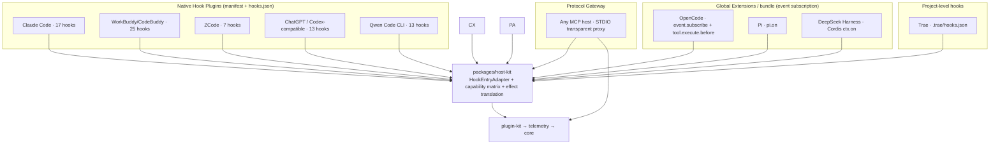

[中文版](../plugins.md) · English

# Concrete Plugins `plugins/*`

Concrete plugins are where the "core key implementation" lands. Each plugin is responsible for a single host, programs against `plugin-kit`, and contains no detection or planning algorithms. All host plugins share the entry bridge, capability matrix, and effect translation from `packages/host-kit`; writing their own recorder is prohibited.

## Integration Topology

Ten integration approaches (9 Agent platforms + the MCP gateway) converge on the same `HostAdapter` contract:



> Like every other plugin, the mcp gateway is orchestrated by `plugin-kit` (`HostAdapter` + `PluginRuntime`) while reusing host-kit's `createAuditSink` for audit persistence — it does not bypass the shared runtime to reach the core directly.

## Module Responsibilities

Implementing `HostAdapter` for a single host involves three things:

1. **subscribe** — listen to host lifecycle events (reasoning, tool calls, command execution)
2. **normalize** — serialize native host events into `ExecutionContext`
3. **materialize** — turn the `SteeringEffect` list into host actions in order (inject prompts, rewrite arguments, suspend/block for approval)

Hook-type plugins are one-shot calls with a no-op `subscribe`; `HookEntryAdapter` produces the host output synchronously after `await runtime.run()` inside the entry point. Event-subscription plugins (OpenCode / Pi / DeepSeek) inject `subscribeFn` and call `reset()` before each event to avoid decision residue.

## Plugin Inventory

| Plugin | Package Name | Host | Adaptation Method | Capability Tier | Actually Enforceable Corrections |
|---|---|---|---|---|---|
| claude-code | `@chaos-design/arcs-plugin-claude-code` | Claude Code | Native Hook (17) | A | L1 arg patching / L2 injection / L4 `permissionDecision: ask` |
| opencode | `@chaos-design/arcs-plugin-opencode` | OpenCode | Global plugin + tool middleware | A | L1 arg patching / L2 injection / L4 permission-prompt suspension |
| zcode | `@chaos-design/arcs-plugin-zcode` | ZCode | Native Hook (7) | B | L2 injection / L4 downgraded to blocking |
| workbuddy | `@chaos-design/arcs-plugin-workbuddy` | WorkBuddy / CodeBuddy Code | Native Hook (25) | B | L2 injection / L4 downgraded to blocking |
| pi | `@chaos-design/arcs-plugin-pi` | Pi | Global extension `pi.on` | B | L2 injection / L4 downgraded to blocking |
| deepseek | `@chaos-design/arcs-plugin-deepseek` | DeepSeek Harness | Cordis bundle | B | L2 injection / L4 broadcast block decision (requires host consumption) |
| trae | `@chaos-design/arcs-plugin-trae` | Trae | Project-level hooks (13) | C | Collection and audit only; injection depends on host permission; no blocking |
| chatgpt | `@chaos-design/arcs-plugin-chatgpt` | ChatGPT / Codex-compatible hooks | Native hooks (13) | A | L1 arg patching / L2 injection / L4 downgraded to `deny` |
| qwen-code | `@chaos-design/arcs-plugin-qwen-code` | Qwen Code CLI | Gemini-compatible hooks (13) | B | L2 injection / L4 downgraded to blocking (no arg patching) |
| mcp | `@chaos-design/arcs-plugin-mcp` | All MCP-capable hosts | STDIO transparent proxy | Gateway | L1 arg patching / L2 virtual error / L3 reroute / L4 blocking |

> ChatGPT / Qwen Code hook contracts follow the Claude/Codex-compatible shape (`--event` + stdin JSON). Real host versions require integrator verification; until then, use the conservative capability declarations above. The OpenAI host (ChatGPT / Codex) is covered by the single `chatgpt` plugin, and the Pi host by the single `pi` plugin.

### Capability Matrix (code at `packages/host-kit/src/capabilities.ts`)

| Host | Tier | Patch Args L1 | Change Tool Name L3 | Inject Prompt L2/L3 | Suspend for Approval L4 | Block L4 |
|---|---|---|---|---|---|---|
| claude-code | A | ✅ | ❌ | ✅ | ✅ `ask` | ✅ |
| opencode | A | ✅ | ❌ | ✅ | ✅ `permission.ask` | ✅ |
| zcode | B | ❌ | ❌ | ✅ | ❌ | ✅ |
| workbuddy | B | ❌ | ❌ | ✅ | ❌ | ✅ |
| pi | B | ❌ | ❌ | ✅ | ❌ | ✅ |
| deepseek | B | ❌ | ❌ | ✅ | ❌ | ✅ (event broadcast) |
| trae | C | ❌ | ❌ | ⚠️ Conditional | ❌ | ❌ |
| chatgpt | A | ✅ | ❌ | ✅ | ❌ (ask → deny) | ✅ `deny` |
| qwen-code | B | ❌ | ❌ | ✅ | ❌ | ✅ |

**Why "changing the tool name" is ❌ for all host plugins**: The pre-Hooks in Claude Code / Codex / OpenCode can only rewrite the arguments of the **same tool** (`updatedInput`); they cannot swap `read` for `grep`. On these plugins, `RedirectTool` is always downgraded to "inject a safe alternative tool suggestion". The only thing that can genuinely change the tool name is the MCP transparent proxy (rewriting `tools/call.name`).

**Why L4 is widely downgraded**: Hooks have a 5-second timeout while HITL waits 120 seconds by default, so synchronously waiting for approval would stall the Agent. Hook-type plugins therefore only return the host's native `ask`/`deny` semantics (or inject a prompt + fail-open pass-through) and never wait long inside the entry point. `packages/host-kit/src/conformance.test.ts` pins down "capability declaration ↔ actual downgrade behavior" with 6 tests to prevent declaration drift.

### Session Claim Ownership and Real Blocking Channel (Deep Dive)

- **File-lock claim**: OpenCode / Pi no longer use an in-process `Set`; they use `host-kit`'s `SessionClaim` instead (`<home>/<source>/.claims/<sessionId>.claim`, atomically acquired via `open('wx')`, recording the pid). A takeover is allowed only when the old owner has exited (`process.kill(pid,0)` returns `ESRCH`) or the TTL (30 minutes by default) has elapsed; `EPERM` is treated as alive and does not trigger takeover. **Multiple processes must share the same `ARCS_HOME` (or `ARCS_CLAIM_HOME`)**, otherwise each holds an independent lock and mutual exclusion fails.
- **Internal injection write-back contract** (corrected on 2026-11-17 based on the locally installed Pi type definitions and the official OpenCode plugin types): Pi's `before_agent_start` injection must be a structured object `{ message: { customType, content, display } }` (a bare string is invalid); OpenCode's context injection can only push to `event.system[]` via `session.hook('context')` (the output of `tool.execute.before` only has `args`; writing custom fields such as `arcsContext` has no effect). Both previous approaches were ineffective; they have been corrected and locked down with unit tests.
- **DeepSeek real blocking**: `apply(ctx, config)` accepts an optional `blockTransport(decision, raw) => Promise<boolean>`. When the host injects this callback, an L4 `block` decision invokes it to genuinely reject tool execution and marks `enforced: true` in the `arcs/decision` event. When it is not injected, the degraded form of event broadcast + audit is retained with `enforced: false`. Any exception thrown by the channel fails open.

```ts
apply(ctx, {
  goal: 'safe refactor',
  blockTransport: async (decision, raw) => {
    // The host implements the actual rejection callback; returning true means blocked
    return ctx.host.rejectTool(raw.payload.toolUseId, decision.reason);
  },
});
```

- **Contract guardrails**: In addition to statically validating the manifest/hooks structure, event counts, and capability matrix of the 9 platforms, `pnpm verify:contracts` also **actually executes** the `serialize*` functions of ChatGPT / Claude Code / ZCode and feeds their output into the official rule assertor (the check count is whatever `pnpm verify:contracts` reports at run time). Fixtures come from the [Codex official output schema](https://github.com/openai/codex/blob/main/codex-rs/hooks/schema/generated/pre-tool-use.command.output.schema.json), and parsing rules come from [output_parser.rs](https://github.com/openai/codex/blob/main/codex-rs/hooks/src/engine/output_parser.rs). Note: **the schema lags behind the parser** — `allow` must be paired with `updatedInput`, `deny` must carry a non-empty reason, and `ask` is always rejected; these rules exist only in the parser. Behavior-level validation is implemented accordingly and has caught and fixed multiple output violations that would have broken blocking (Codex orphaned `allow` / `deny` without a reason; Claude outputting the illegal enum `block`; WorkBuddy/Trae misusing the `decision` field instead of `permissionDecision`; `additionalContext` wrongly placed at the top level). These behavior-level checks cover all 6 Hook platforms (the total count is whatever `pnpm verify:contracts` reports at run time), split by platform: ChatGPT uses the Codex parser rules, while the other five follow the Claude-compatible shape (`permissionDecision` and `additionalContext` both inside `hookSpecificOutput`; WorkBuddy's arg-patching field is `modifiedInput`). It is a regression guardrail and does not replace real host verification.
- **Local audit evidence**: Once `ARCS_HOME` or `ARCS_AUDIT_FILE` is set, all plugins append `AuditEvent` to `<home>/audit/<host>/<YYYY-MM-DD>.jsonl`; `pnpm real-check` probes the CLI and provides real-session steps, while `pnpm real-check -- --verify` counts audit events. When the variables are not set, nothing is written to disk and behavior is unchanged. See [telemetry.md](./telemetry.md) for details.

## Shared Runtime `packages/host-kit`

- `HookEntryAdapter` — the sole one-shot Hook adapter, also serving as the base class for event-subscription platforms (inject `subscribeFn` as the 4th argument)
- `runHookEntry` — `stdin → NativeEvent → RawEvent → PluginRuntime.run → host output`, failing open on any exception (exit 0 / stderr only)
- `HOST_CAPABILITIES` — the 11-platform capability matrix; plugins may only reference it, not hard-code it
- `parseHookPayload / withHookEvent / serializeHookDecision / hookContextText` — **shared hook primitives**: plugins declare only field aliases and decision profiles; JSON parsing, degradation text and output assembly have a single implementation
- `makeNativeEvent / shouldSteerPreToolUse` — shared event construction and decision gate for subscription-based plugins
- `applyEffect / translateEffects` — translate `SteeringEffect` into `HostDecision` according to capabilities; any capability gap is downgraded + leaves an audit trace
- `nativeToRaw / pickString / pickRecord / toolCallFromNative` — event mapping primitives

See [extension-points.md](./extension-points.md) for the steps to add a new host plugin.

## MCP Proxy Enforcement Semantics (Implemented, STDIO Line-Delimited JSON-RPC)

| Effect | Proxy Enforcement Action |
|---|---|
| `PassThrough` | Forward downstream as-is |
| `PatchArgs` (L1) | Rewrite `arguments` then forward (patch is the complete set of repaired arguments) |
| `RedirectTool` (L3) | Rewrite the `tools/call` target tool then forward (the original call is blocked) |
| `InjectMessage` (L2) | Do not forward downstream; synthesize an `isError: true` tool result (virtual error) |
| `Suspend` (L4) | Do not forward downstream; synthesize a blocking-prompt result (rejection semantics, no approval channel) |

> Decision rule: if the effect list of a call contains any forwarding (including rerouting), the last forwarding action takes precedence — L3 injection has no result channel after a reroute and is skipped; otherwise the last synthesized response is used. Interception is processed in a serial queue to guarantee consistency with request order.

```bash
npx @chaos-design/arcs-plugin-mcp \
  --goal "Only fix frontend styling bugs; do not modify backend API routes" \
  --target "npx -y @modelcontextprotocol/server-filesystem ./src" \
  [--drift-threshold 0.75] [--max-consecutive-loops 2] [--protected-paths ".env*,**/migrations/**"]
```

## Configuration Example

A host plugin's goal is injected via `--goal` or the `ARCS_GOAL` environment variable; configuration such as thresholds is passed into the `host` overlay of `PluginRuntime` via `ARCS_*` environment variables or a plugin config file.

```bash
export ARCS_GOAL="Refactor src/auth; do not modify database migration files under any circumstances"
claude --plugin-dir /abs/path/to/arcs/plugins/claude-code
```

## Unified CLI Quick Start (`packages/cli`)

`@chaos-design/arcs-cli` (bin `arcs`) handles "discovery + launch" and does not duplicate each plugin's capability declarations:

```bash
npx @chaos-design/arcs-cli list                     # list all plugins
npx @chaos-design/arcs-cli start mcp -- --goal "..." --target "..."  # start the resident MCP proxy
npx @chaos-design/arcs-cli start mcp --dry-run      # print the command without starting
npx @chaos-design/arcs-cli start claude-code        # for Hook-type, print how to enable in the host
```

`mcp` is the only plugin with a standalone resident service; `start` resolves its bin and launches a stdio proxy subprocess, passing through arguments after `--` verbatim. The remaining Hook / global-extension plugins are loaded by the host, and the CLI provides the enablement command and a capability summary. See [packages/cli/README.md](../../packages/cli/README.md).

## Installation and Build

```bash
# Build all host plugins (host-kit → 9 packages, incl. the mcp gateway)
pnpm build:native-plugins

# Install a single platform (Trae writes project hooks; OpenCode / Pi copy to the global directory)
node scripts/install-host-plugins.mjs --client=trae --target=/abs/path/to/workspace
node scripts/install-host-plugins.mjs --client=opencode
node scripts/install-host-plugins.mjs --client=pi

# DeepSeek goes through Cordis bundle integration (prints guidance; see plugins/deepseek/README.md)
node scripts/install-host-plugins.mjs --client=deepseek

# Plugin-directory platforms load from a local directory (the script prints the enable commands; see each plugin's README)
node scripts/install-host-plugins.mjs --client=claude-code
```
