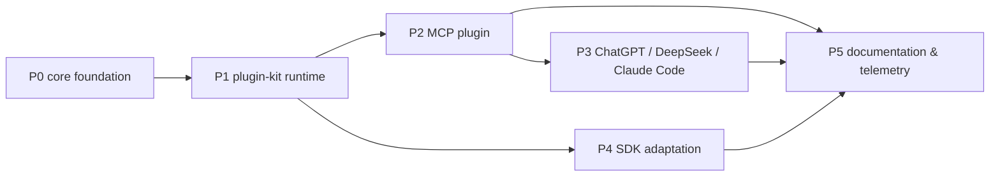

[中文版](../roadmap.md) · English

# Implementation Roadmap

| Phase | Goal | Key deliverables | Definition of Done (DoD) | Status |
|---|---|---|---|---|
| **P0** | core foundation | Models, interfaces, pure detection algorithms | Type checking passes; core algorithm unit-test coverage; **failure-degradation unit tests pass** (sensor skip / global PassThrough+degraded); dependency scan confirms zero host dependencies | ✅ 2026-11-17 |
| **P1** | plugin-kit runtime | `HostAdapter`, `PluginRuntime`, SessionState, Config/HITL/Telemetry bridges | **ReplayHarness replay simulation passes** (effect-list order, budget, degraded, three HITL branches); mock adapter runs the full capture→sense→plan→apply chain in unit tests | ✅ 2026-11-17 |
| **P2** | First plugin (MCP) | `plugins/mcp` end-to-end | Real MCP Server mounting, L1/L2 correction observable, audit events queryable | ✅ 2026-11-17 |
| **P3** | Host plugins for all platforms (9 vendors) | `HostAdapter` for chatgpt / deepseek / claude-code / zcode / workbuddy / opencode / pi / trae / qwen-code + shared host-kit runtime and hook primitives | Contract guards (`verify:contracts`) and mock host / subprocess fixtures all green; **real host process testing is performed by the integrator** (`scripts/host-real-check.mjs`) | ✅ 2026-11-17 (real-host testing pending integrator) |
| **P4** | SDK adaptation | `sdk/vercel`, `sdk/langchain` | Each demo runs through, `SteerEvent` fields correct, boundary constraints pass review | ✅ 2026-11-17 (doStream pass-through trimmed for v1, see docs/sdk.md) |
| **P5** | Documentation and telemetry | Architecture docs, Mermaid diagrams, drift-curve dashboard | README and docs synchronized; all diagrams render; drift curves can be aggregated from JSONL and visualized (`pnpm dashboard`, terminal + `--html`) | ✅ 2026-11-18 |

## Phase dependencies

## Implementation principles

- Complete and verify each phase before moving to the next; do not batch up unfinished items.
- When a decision falls outside the scope of the code (product / security / release / platform), record it as an open item rather than pressing ahead on assumptions.
- Update documentation in sync with implementation; keep README consistent with docs.
- See [testing.md](./testing.md) for the mapping between test tiers and each phase's DoD; each plan is managed through the repository's `plans/` directory using the plan-flow process (see `plans/README.md` for the status and priority contract).
