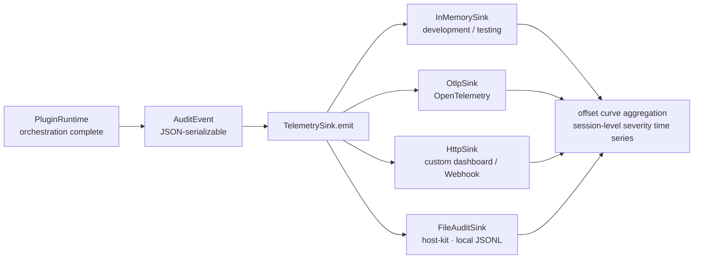

[中文版](../telemetry.md) · English

# Telemetry `packages/telemetry`

## Package Role

The data model and receiver-contract package: it defines `AuditEvent` and `TelemetrySink`, takes no part in decision-making, and is host-agnostic.

- **Dependency direction**: a single chain `plugins → plugin-kit → telemetry → core`; telemetry depends only on core (consuming output types such as `DriftSignal` / `SteeringEffect`).
- **Depended on by**: the glue layer emits an audit event after every orchestration run; `sdk/*` may depend directly on telemetry for reporting as needed.

## AuditEvent Model

```typescript
interface AuditEvent {
  ts: number;
  sessionId: string;
  host: string;                   // codex / deepseek / claude-code / mcp / sdk-vercel / sdk-langchain
  level: 1 | 2 | 3 | 4 | null;    // trigger level, null = no-drift pass-through
  signals: DriftSignal[];
  effects: SteeringEffect[];      // ordered effect list actually materialized
  latencyMs: number;              // time spent in normalize + sense + plan
  degraded: boolean;              // fail-open degradation flag (see constraints.md #7)
  hitl?: { approved: boolean; timeout: boolean };   // present only for L4
}
```

## Audit Event Flow



## TelemetrySink Contract

```typescript
interface TelemetrySink {
  emit(e: AuditEvent): void;
}
```

Implementation requirements (must be followed when extending; see [extension-points.md](./extension-points.md)):

- `emit` **must not throw** — telemetry failures are silently dropped and must never affect the steering main chain;
- Synchronous implementations must take < 1ms, otherwise switch to internal buffering + asynchronous flushing;
- No blocking I/O, no backpressure on the host.

### FileAuditSink (local persistence, in `packages/host-kit`)

To make "real-host integration testing" verifiable, `host-kit` provides `FileAuditSink` (implementing `TelemetrySink`), preserving the telemetry package's zero-I/O, pure-logic boundary:

- Path: `ARCS_AUDIT_FILE` specifies an exact file; otherwise `<ARCS_HOME>/audit/<host>/<YYYY-MM-DD>.jsonl` (`ARCS_HOME` defaults to `~/.arcs`)
- Writes: `appendFileSync` writes a whole line in one shot; failures are silent (telemetry must not block the main chain)
- Content: only validated structured `AuditEvent` fields, **no raw prompts or tool arguments**; `evidence` may contain path information, so manage file permissions accordingly
- Wiring: `runHookEntry`, the three subscription-based plugins (opencode/pi/deepseek), and the `arcs-plugin-mcp` CLI construct the sink from environment variables by default; when no variables are set, no sink is created and behavior is exactly as before

To verify a real session:

```bash
export ARCS_HOME=~/.arcs
# start a real Agent session with your own account and trigger a tool call
node scripts/host-real-check.mjs --verify   # report event count, per-host/per-level breakdown, degradation count
```

## Offset Curve (Steering Arc Curve)

The core analytical product of telemetry: a curve aggregating `DriftSignal.severity` by `sessionId` over event order, used to answer two questions —

1. **Is it converging**: after steering intervenes, does severity decrease monotonically and do drift intervals grow longer;
2. **Is it over-steering**: the PassThrough ratio, PatchArgs hit rate, and HITL false-positive rate.

Output is JSONL (one `AuditEvent` per line), consumed by visualization dashboards and replay simulation ([testing.md](./testing.md)).

### Offset Curve Dashboard (roadmap P5, implemented)

The repo ships a zero-dependency dashboard script (`scripts/offset-dashboard.mjs`, i.e. `pnpm dashboard`):

```bash
corepack pnpm dashboard                                    # read $ARCS_HOME/audit/**/*.jsonl, terminal stats + per-session sparkline
corepack pnpm dashboard --file audit.jsonl --html panel.html   # generate a standalone HTML panel (inline SVG, zero external resources, open directly in a browser)
corepack pnpm dashboard --session demo- --limit 5          # filter by session prefix / limit displayed entries
```

- Aggregation semantics are separated from rendering: the data model is produced by `buildDashboardModel` (a pure function) from `@chaos-design/arcs-telemetry` — level histogram, three HITL branches (approved/rejected/timed out, mutually exclusive), pass-through ratio, and per-session convergence determination (mean of last 3 points < mean of first 3 points);
- The dashboard answers two questions: **is it converging** (the tail of the severity curve shifts downward) and **is it over-steering** (an excessively high pass-through ratio = missed detections, PatchArgs hit rate and HITL false positives);
- Custom dashboard / OTLP consumers can reuse `buildDashboardModel` directly, and the rendering layer is replaceable (see [extension-points.md](./extension-points.md) for extension points).
