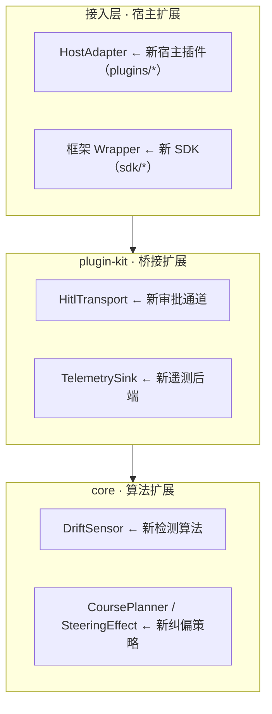

[English](./en/extension-points.md) · 中文

# 扩展点

ARCS 在每一层都预留了稳定扩展点，扩展无需改动 core。

## 扩展点全景

## 扩展点清单

| 扩展点 | 位置 | 扩展方式 | 典型场景 | 是否触碰 core |
|---|---|---|---|---|
| 新检测算法 | core | 实现 `DriftSensor` 并注册 | 自定义相似度、领域规则 | 新增实现，不改内核 |
| 新纠偏策略 | core | 扩展 `SteeringEffect` + `CoursePlanner` | 新增降级路由策略 | 需扩展判别联合 |
| 新宿主插件 | plugins | 实现 `HostAdapter` | Cursor、Windsurf 等 | 否 |
| 审批通道 | plugin-kit | 实现 `HitlTransport` | 企业 IM、Webhook | 否 |
| 遥测后端 | telemetry | 实现 `TelemetrySink` | OpenTelemetry、自建面板 | 否 |
| 新 SDK 适配 | sdk | 框架原生 Wrapper 包装 core | 新 Agent 框架 | 否 |

## 扩展契约注意事项

- **审批通道**：实现**必须带超时语义**（默认 120s，超时视为拒绝），不得无限挂起执行流；返回 `HitlDecision` 必须显式携带 `timeout` 字段。理由见 [key-flows.md](./key-flows.md) 的挂起-恢复流程。
- **遥测后端**：`emit` 不得抛异常、同步路径 < 1ms，否则内部缓冲异步冲刷；契约见 [telemetry.md](./telemetry.md)。
- **新检测算法**：保持纯函数、同步、无 I/O；不改 `ExecutionContext` 契约；重模型判断走异步旁路（结果进入下一事件窗口）。
- **新纠偏策略**：扩展判别联合时必须保持可 JSON 化（约束 #3）并同步更新序列化单测与回放仿真用例。

## 新增宿主插件步骤

1. 在 `plugins/<host>/` 新建包，依赖 `plugin-kit` 与宿主 SDK。
2. 实现 `HostAdapter` 的 `subscribe` / `normalize` / `materialize`。
3. 复用 `PluginRuntime` 编排流水线，不重复实现检测与规划、状态管理与 fail-open 兜底。
4. 按 `ConfigSchema` 暴露宿主配置项（阈值、保护路径、操舵模式）。
5. 补端到端测试：验证 L1–L4 在真实宿主中的「任务不中断」行为（见 [testing.md](./testing.md)）。

## 新增检测算法步骤

1. 实现 `DriftSensor.sense(ctx): DriftSignal[]`。
2. 保持纯函数、同步、无 I/O。
3. 在 core 注册并补充单测（含异常跳过的降级行为）；不改 `ExecutionContext` 契约。
