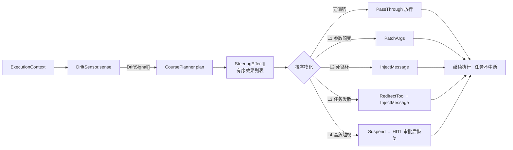
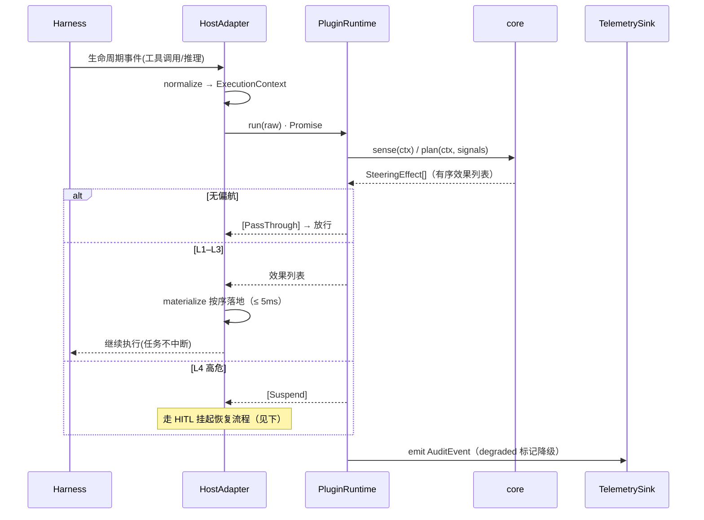
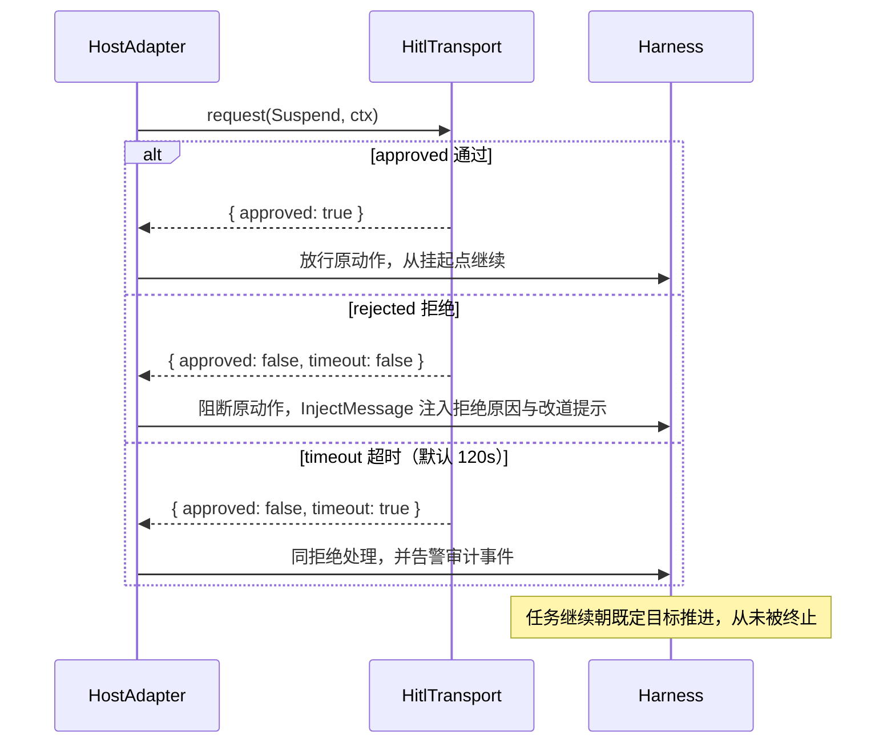
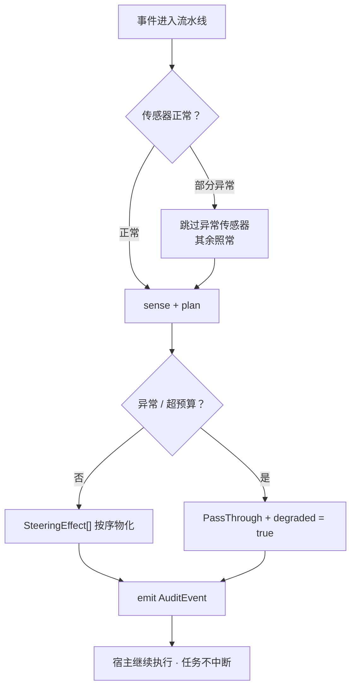

[English](./en/key-flows.md) · 中文

# 关键流程

## 纠偏闭环主流程

体现「不中断 + 及时纠偏」：纠偏对象始终是偏航的动作，而非任务本身。`plan` 输出**有序效果列表**，运行时按序物化，组合表达「阻断 + 注入」类复合纠偏。

## 插件运行时序

## 四级纠偏策略

| 偏航等级 | 典型场景（SDK 与 Harness 通用） | 效果类型 | 操舵效果（任务不中断） |
| :--- | :--- | :--- | :--- |
| **L1 · 参数畸变** | 工具调用 JSON 格式错误、路径拼写幻觉 | `PatchArgs` | 毫秒级自动修复参数字段，宿主无感放行，任务继续推进。 |
| **L2 · 终端死循环** | 连续 3 次运行同一报错命令 | `InjectMessage` | 在重复执行前注入虚拟报错提示，引导切换排查思路，而非终止任务。 |
| **L3 · 任务发散** | 修 Bug 时擅自重构无关目录 | `RedirectTool` + `InjectMessage` | 阻断越界写入并注入强约束指令，把焦点拉回既定目标（Goal）。 |
| **L4 · 高危越权** | 试图执行 `rm -rf` 或修改受保护的 `.env` | `Suspend` | 挂起单个高危动作并触发交互 / Webhook 审批，审批后恢复，任务得以安全延续。 |

## HITL 挂起-恢复流程

L4 是唯一的「暂停」场景，但暂停的是单个动作，不是任务：审批通过后从挂起点恢复；拒绝或超时则阻断该动作并注入解释，任务继续朝目标推进。

## 失败降级路径（fail-open）

检测/规划链路自身的任何异常都不允许中断宿主任务——降级放行并留下审计痕迹：

降级行为分层：单传感器异常→跳过；整体异常/超预算→PassThrough + degraded；materialize 异常→放行原始调用 + 告警。契约细节见 [plugin-kit.md](./plugin-kit.md) 的「失败兜底」一节。
