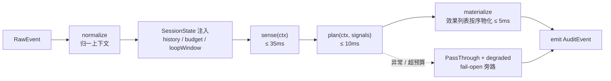

[English](./en/plugin-kit.md) · 中文

# 插件胶水层 `packages/plugin-kit`

插件胶水层承接全部宿主耦合：把宿主生命周期事件转成 core 能理解的上下文，再把 core 的决策物化成宿主动作。它是「核心关键实现聚焦 plugin」的共享底座——所有插件都基于它构建，重复逻辑只写一次。

## 编排流水线



## 模块职责

- 定义 `HostAdapter` 契约（事件采集、上下文归一、决策落地）
- `PluginRuntime` 编排流水线：采集 → 归一 → 状态注入 → 检测 → 规划 → 落地 → 上报
- 会话状态管理（`SessionState`）：循环窗口、历史环形缓冲、预算计数
- 配置加载与校验（Zod Schema），配置优先级仲裁
- HITL 审批通道桥接、遥测上报桥接、fail-open 降级兜底

## 核心抽象

| 抽象 | 作用 |
|---|---|
| `HostAdapter` | 宿主适配契约：subscribe / normalize / materialize |
| `PluginRuntime` | 运行时编排器 `run(raw: RawEvent): Promise<SteeringOutcome>` |
| `RawEvent` | 宿主原始事件：host、type、sessionId、timestamp、payload |
| `SteeringOutcome` | 单次编排结果：effects、signals、latencyMs、degraded |
| `SessionState` | 按 sessionKey 分桶的会话状态（循环窗口 / 历史 / 预算） |
| `ConfigSchema` | 插件配置 Schema（阈值、保护路径、操舵模式） |
| `HitlTransport` | 审批通道 `request(e, ctx): Promise<HitlDecision>` |
| `TelemetrySink` | 遥测接收契约，**定义于 packages/telemetry**，kit 依赖并调用 |
| `EffectMaterializer` | 把 `SteeringEffect` 列表按序映射为宿主动作 |

## 接口边界（设计签名）

```typescript
interface RawEvent {
  host: string;                // 'codex' | 'deepseek' | 'claude-code' | 'mcp' | ...
  type: 'tool-call' | 'thought' | 'command';
  sessionId: string;           // 宿主会话标识，作为 sessionKey
  timestamp: number;
  payload: unknown;            // 宿主原生事件数据
}

interface SteeringOutcome {
  effects: SteeringEffect[];   // plan 输出的有序效果列表
  signals: DriftSignal[];
  latencyMs: number;           // normalize + sense + plan 耗时
  degraded: boolean;           // 任一环节降级即置位
}

interface HostAdapter {
  subscribe(notify: (raw: RawEvent) => void): void;
  normalize(raw: RawEvent): ExecutionContext;
  materialize(effect: SteeringEffect, ctx: ExecutionContext): Promise<MaterializeResult>;
  setup?(handles: KitHandles): void | Promise<void>;  // Runtime 初始化时注入 hitl 与最终配置
}

interface KitHandles { hitl: HitlTransport; config: ArcsConfig }

type MaterializeResult =
  | { applied: true }                       // 效果已落地 / 原动作放行
  | { applied: false; reason: string };     // 原动作被阻断（如 HITL 拒绝）

class PluginRuntime {
  constructor(adapter: HostAdapter, opts: {
    hitl: HitlTransport;
    sink: TelemetrySink;
    config: ConfigSchema;
  });
  run(raw: RawEvent): Promise<SteeringOutcome>;   // 异步：materialize 与 HITL 可 await
}

interface HitlTransport {
  request(e: Suspend, ctx: ExecutionContext): Promise<HitlDecision>;
}

interface HitlDecision {
  approved: boolean;
  timeout: boolean;            // 超时视为拒绝
  comment?: string;
}

interface SessionState {
  sessionKey: string;
  loopWindow: ToolCall[];      // 滑动窗口（默认 8 条）
  history: Snapshot[];         // 环形缓冲（默认 20 条）
  budget: Budget;
  lastActiveAt: number;
}
```

## 状态所有权

滑动窗口循环哈希、历史累积与预算扣减都需要跨事件状态，归属如下：

- 状态由 `PluginRuntime` 持有，按 `sessionKey`（取自 `RawEvent.sessionId`）分桶，core 不持有任何状态（保持纯函数）；
- `normalize` 后由 kit 把 `SessionState.history`（环形缓冲）与 `budget` 以**快照**形式注入 `ExecutionContext`——注入视图只含既往事件，当前调用在检测完成后才写入历史（避免循环重复被双重计数）；TTL 清扫以事件时钟为基准，保证轨迹回放的确定性；
- `HostAdapter.setup` 在运行时初始化时被调用，注入 `hitl` 与三级合并后的最终配置，`materialize(Suspend)` 据此在适配器内部完成审批挂起；
- 默认容量：loop 窗口 8 条、history 20 条，可在 `ConfigSchema` 覆盖；
- **TTL 清理**：会话空转超过阈值（默认 30 分钟）即回收 `SessionState`，防止长驻进程内存泄漏。

## HITL 挂起与恢复契约

L4 的 `Suspend` 是唯一挂起点，挂起的是**单个动作**而非任务：

1. `materialize(Suspend)` 内部调用 `hitl.request(e, ctx)` 并 await；
2. **通过** → 放行原动作，返回 `{ applied: true }`，任务从挂起点继续；
3. **拒绝或超时**（默认 120s，可配置）→ 阻断原动作，等价物化为 `InjectMessage`（向宿主注入拒绝原因与改道提示），返回 `{ applied: false, reason }`，任务继续朝目标推进；
4. 审批通道实现**必须带超时语义**，不得无限挂起执行流。

## 配置优先级

```
内置默认 < Policy 默认 < 宿主配置
```

- 三级依次覆盖，最终生效配置由 kit 仲裁后传入 core 的 `Policy`；
- 运行时热更新只允许宿主配置级覆盖，**下一事件生效**，不做中途事务与回放；
- 配置变更本身产生一条 `AuditEvent`（degraded=false，effects 为空，备注变更内容）。

## 失败兜底（fail-open 落地）

`PluginRuntime.run` 对整条流水线做逐级包裹，任何异常不外抛到宿主：

| 失败点 | 行为 |
|---|---|
| 单个传感器异常 / 超时 | 跳过该传感器，用已产出信号继续 |
| sense + plan 整体异常 / 超预算 | 返回 `[PassThrough]`，`degraded = true` |
| materialize 异常 | 放行原始调用，`degraded = true` + 告警事件 |
| sink.emit 异常 | 静默丢弃该条遥测（遥测失败不影响主链） |

## 与 core 的拆分边界

| 关注点 | core | plugin-kit |
|---|---|---|
| 偏航检测算法 | ✅ | ❌ |
| 航向规划决策 | ✅ | ❌ |
| 宿主事件采集 | ❌ | ✅ |
| 上下文归一 | ❌ | ✅ |
| 会话状态（SessionState） | ❌ | ✅ |
| 决策物化落地 | ❌ | ✅ |
| 配置 / 审批 / 遥测桥接 | ❌ | ✅ |
| 宿主 SDK import | ❌ | ❌（下沉到 plugins） |

关键点：core 输出可序列化的有序 `SteeringEffect` 列表，「如何按序物化成宿主动作」完全由胶水层决定。这让同一套算法可以复用到任意宿主。

## 依赖关系与交互

- **依赖**：`core` 与 `telemetry`（消费 `AuditEvent` / `TelemetrySink` 契约）；按需使用宿主无关的工具库；不 import 任何宿主 SDK。
- **被依赖**：`plugins/*` 实现 `HostAdapter` 并复用 `PluginRuntime`。
- **交互**：对上承接宿主生命周期事件，对下调用 core 的 `sense/plan`，再把效果列表按序物化为宿主动作。

时序见 [key-flows.md](./key-flows.md)，新增宿主流程见 [extension-points.md](./extension-points.md)，遥测契约见 [telemetry.md](./telemetry.md)。
