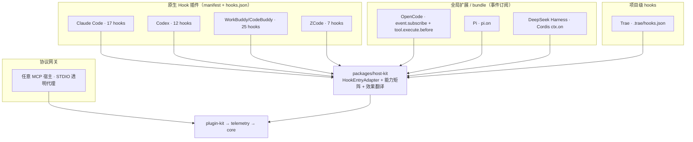

# 具体插件 `plugins/*`

具体插件是「核心关键实现」的落地点。每个插件只负责一个宿主，面向 `plugin-kit` 编程，不包含检测或规划算法。所有宿主插件共用 `packages/host-kit` 的入口桥、能力矩阵与效果翻译，禁止各写一套 recorder。

## 接入拓扑

九种接入方式（8 个 Agent 平台 + MCP 网关）收敛到同一个 `HostAdapter` 契约：



## 模块职责

针对单一宿主实现 `HostAdapter` 三件事：

1. **subscribe** — 监听宿主生命周期事件（推理、工具调用、命令执行）
2. **normalize** — 把宿主原生事件序列化为 `ExecutionContext`
3. **materialize** — 把 `SteeringEffect` 列表按序变成宿主动作（注入提示、改写参数、挂起/阻断审批）

Hook 型插件是一次性调用，`subscribe` 为空操作，由 `HookEntryAdapter` 在入口内 `await runtime.run()` 后同步产出宿主输出；事件订阅型插件（OpenCode / Pi / DeepSeek）注入 `subscribeFn` 并在每条事件前调用 `reset()`，避免决策残留。

## 插件清单

| 插件 | 包名 | 宿主 | 适配方式 | 能力等级 | 实际可落地的纠偏 |
|---|---|---|---|---|---|
| claude-code | `@chaos-design/arcs-plugin-claude-code` | Claude Code | 原生 Hook（17） | A | L1 改参 / L2 注入 / L4 `permissionDecision: ask` |
| codex | `@chaos-design/arcs-plugin-codex` | OpenAI Codex CLI | 原生 Hook（12） | A | L1 改参 / L2 注入 / L4 降为 `deny` |
| opencode | `@chaos-design/arcs-plugin-opencode` | OpenCode | 全局插件 + 工具中间件 | A | L1 改参 / L2 注入 / L4 权限询问挂起 |
| zcode | `@chaos-design/arcs-plugin-zcode` | ZCode | 原生 Hook（7） | B | L2 注入 / L4 降为阻断 |
| workbuddy | `@chaos-design/arcs-plugin-workbuddy` | WorkBuddy / CodeBuddy Code | 原生 Hook（25） | B | L2 注入 / L4 降为阻断 |
| pi | `@chaos-design/arcs-plugin-pi` | Pi | 全局扩展 `pi.on` | B | L2 注入 / L4 降为阻断 |
| deepseek | `@chaos-design/arcs-plugin-deepseek` | DeepSeek Harness | Cordis bundle | B | L2 注入 / L4 广播阻断决策（需宿主消费） |
| trae | `@chaos-design/arcs-plugin-trae` | Trae | 项目级 hooks（13） | C | 仅采集与审计；注入依赖宿主允许；不阻断 |
| mcp | `@chaos-design/arcs-plugin-mcp` | 所有支持 MCP 的宿主 | STDIO 透明代理 | 网关 | L1 改参 / L2 虚拟报错 / L3 改道 / L4 阻断 |

### 能力矩阵（代码位于 `packages/host-kit/src/capabilities.ts`）

| 宿主 | 级别 | 改参数 L1 | 改工具名 L3 | 注入提示 L2/L3 | 挂起审批 L4 | 阻断 L4 |
|---|---|---|---|---|---|---|
| claude-code | A | ✅ | ❌ | ✅ | ✅ `ask` | ✅ |
| codex | A | ✅ | ❌ | ✅ | ❌（官方不支持 `ask`） | ✅ `deny` |
| opencode | A | ✅ | ❌ | ✅ | ✅ `permission.ask` | ✅ |
| zcode | B | ❌ | ❌ | ✅ | ❌ | ✅ |
| workbuddy | B | ❌ | ❌ | ✅ | ❌ | ✅ |
| pi | B | ❌ | ❌ | ✅ | ❌ | ✅ |
| deepseek | B | ❌ | ❌ | ✅ | ❌ | ✅（事件广播） |
| trae | C | ❌ | ❌ | ⚠️ 条件性 | ❌ | ❌ |

**为什么所有宿主插件的「改工具名」都是 ❌**：Claude Code / Codex / OpenCode 的前置 Hook 只能改写**同一工具**的参数（`updatedInput`），无法把 `read` 换成 `grep`。`RedirectTool` 在这些插件上一律降级为"注入安全替代工具建议"。真正能改工具名的只有 MCP 透明代理（改写 `tools/call.name`）。

**为什么 L4 普遍降级**：Hook 有 5 秒超时，而 HITL 默认等待 120 秒，同步等待审批会把 Agent 卡死。因此 Hook 型插件只返回宿主原生的 `ask`/`deny` 语义（或注入提示 + fail-open 放行），绝不在入口内长等待。`packages/host-kit/src/conformance.test.ts` 用 6 条测试钉死"能力声明 ↔ 实际降级行为"，防止声明漂移。

### 会话记录权与真实阻断通道（深度收尾）

- **文件锁 claim**：OpenCode / Pi 不再用进程内 `Set`，改用 `host-kit` 的 `SessionClaim`（`<home>/<source>/.claims/<sessionId>.claim`，`open('wx')` 原子抢占，记录 pid）。旧 owner 已退出（`process.kill(pid,0)` 为 `ESRCH`）或超过 TTL（默认 30 分钟）才允许接管，`EPERM` 视为存活不接管。**多进程必须共享同一个 `ARCS_HOME`（或 `ARCS_CLAIM_HOME`）**，否则各自持有独立锁、无法互斥。
- **内部注入回写契约**（2026-11-17 依据本机安装的 Pi 类型定义与 OpenCode 官方 plugin 类型修正）：Pi `before_agent_start` 的注入必须是 `{ message: { customType, content, display } }` 结构化对象（裸字符串无效）；OpenCode 的上下文注入只能通过 `session.hook('context')` push `event.system[]`（`tool.execute.before` 的 output 只有 `args`，写 `arcsContext` 等自定义字段无效）。此前两处写法均无效，已修正并有单测锁定。
- **DeepSeek 真实阻断**：`apply(ctx, config)` 接受可选 `blockTransport(decision, raw) => Promise<boolean>`。宿主注入该回调后，L4 的 `block` 决策会调用它真正拒绝工具执行，并在 `arcs/decision` 事件中标记 `enforced: true`；未注入时保持事件广播 + 审计的降级形态，`enforced: false`。通道抛异常一律 fail-open。

```ts
apply(ctx, {
  goal: '安全重构',
  blockTransport: async (decision, raw) => {
    // 由宿主实现真正的拒绝回调；返回 true 表示已阻断
    return ctx.host.rejectTool(raw.payload.toolUseId, decision.reason);
  },
});
```

- **契约护栏**：`pnpm verify:contracts` 除静态校验 8 个平台的 manifest/hooks 结构、事件数量与能力矩阵外，还**实际执行** Codex / Claude Code / ZCode 的 `serialize*` 函数，把输出喂给官方规则断言器（当前 75 项）。fixture 来自 [Codex 官方 output schema](https://github.com/openai/codex/blob/main/codex-rs/hooks/schema/generated/pre-tool-use.command.output.schema.json)，解析规则来自 [output_parser.rs](https://github.com/openai/codex/blob/main/codex-rs/hooks/src/engine/output_parser.rs)。注意：**schema 落后于 parser**——`allow` 必须与 `updatedInput` 成对、`deny` 必须带非空 reason、`ask` 一律拒绝，这几条只有 parser 里有。行为级校验据此实现，已抓到并修复多处会导致阻断失效的输出违规（Codex 孤立 allow / 无理由 deny；Claude 输出非法枚举 `block`；WorkBuddy/Trae 误用 `decision` 字段而非 `permissionDecision`；`additionalContext` 误置顶层）。当前 85 项校验覆盖全部 5 个 Hook 平台，按平台分治：Codex 用 parser 规则，其余四家按 Claude 兼容形态（`permissionDecision` 与 `additionalContext` 都在 `hookSpecificOutput` 内；WorkBuddy 改参字段为 `modifiedInput`）。它是回归护栏，不替代真实宿主验证。
- **本地审计证据**：设置 `ARCS_HOME` 或 `ARCS_AUDIT_FILE` 后，所有插件会把 `AuditEvent` 追加到 `<home>/audit/<host>/<YYYY-MM-DD>.jsonl`；`pnpm real-check` 探测 CLI 并给出真实会话步骤，`pnpm real-check -- --verify` 统计审计事件。未设置变量时不落盘、行为不变。详见 [telemetry.md](./telemetry.md)。

## 共用运行时 `packages/host-kit`

- `HookEntryAdapter` — 唯一的一次性 Hook 适配器，兼作事件订阅型平台的基类（第 4 参注入 `subscribeFn`）
- `runHookEntry` — `stdin → NativeEvent → RawEvent → PluginRuntime.run → 宿主输出`，任何异常都 fail-open（exit 0 / 只写 stderr）
- `HOST_CAPABILITIES` — 8 平台能力矩阵，插件只能引用不能硬编码
- `applyEffect / translateEffects` — 按能力把 `SteeringEffect` 翻译为 `HostDecision`，能力缺口一律降级 + 留审计痕迹
- `nativeToRaw / pickString / pickRecord / toolCallFromNative` — 事件映射基元

新增宿主插件的步骤见 [extension-points.md](./extension-points.md)。

## MCP 代理落地语义（已实现，STDIO 行分隔 JSON-RPC）

| 效果 | 代理落地动作 |
|---|---|
| `PassThrough` | 原样转发下游 |
| `PatchArgs`（L1） | 改写 `arguments` 后转发（patch 为修复后的完整参数） |
| `RedirectTool`（L3） | 改写 `tools/call` 目标工具后转发（原调用被阻断） |
| `InjectMessage`（L2） | 不转发下游，合成 `isError: true` 工具结果（虚拟报错） |
| `Suspend`（L4） | 不转发下游，合成阻断提示结果（拒绝语义，无审批通道） |

> 决策规则：一次调用的效果列表中若存在转发（含改道），以最后一个转发为准——L3 的注入在改道后没有结果通道，跳过；否则取最后一个合成响应。拦截按串行队列处理，保证与请求顺序一致。

```bash
npx @chaos-design/arcs-plugin-mcp \
  --goal "仅修复前端样式 Bug，禁止修改后端 API 路由" \
  --target "npx -y @modelcontextprotocol/server-filesystem ./src" \
  [--drift-threshold 0.75] [--max-consecutive-loops 2] [--protected-paths ".env*,**/migrations/**"]
```

## 配置示例

宿主插件的目标通过 `--goal` 或环境变量 `ARCS_GOAL` 注入；阈值等配置通过 `ARCS_*` 环境变量或插件配置文件传入 `PluginRuntime` 的 `host` 覆盖层。

```bash
export ARCS_GOAL="重构 src/auth，严禁修改数据库迁移文件"
claude --plugin-dir /abs/path/to/arcs/plugins/claude-code
```

## 统一 CLI 快速启动（`packages/cli`）

`@chaos-design/arcs-cli`（bin `arcs`）负责"发现 + 拉起"，不重复各插件的能力声明：

```bash
npx @chaos-design/arcs-cli list                     # 列出全部插件
npx @chaos-design/arcs-cli start mcp -- --goal "..." --target "..."  # 拉起 MCP 常驻代理
npx @chaos-design/arcs-cli start mcp --dry-run      # 只打印命令不启动
npx @chaos-design/arcs-cli start claude-code        # Hook 型打印宿主启用方式
```

`mcp` 是唯一有独立常驻服务的插件，`start` 会解析其 bin 并拉起 stdio 代理子进程，`--` 之后的参数原样透传；其余 Hook / 全局扩展型插件由宿主加载，CLI 给出启用命令与能力摘要。见 [packages/cli/README.md](../packages/cli/README.md)。

## 安装与构建

```bash
# 构建全部宿主插件（host-kit → 8 插件）
pnpm build:native-plugins

# 安装单个平台（Trae 写入项目 hooks；OpenCode / Pi 复制到全局目录）
node scripts/install-host-plugins.mjs --client=trae --target=/abs/path/to/workspace
node scripts/install-host-plugins.mjs --client=opencode
node scripts/install-host-plugins.mjs --client=pi

# 原生 marketplace 平台按各自 CLI 安装（脚本会打印准确命令）
node scripts/install-host-plugins.mjs --client=claude-code
```
