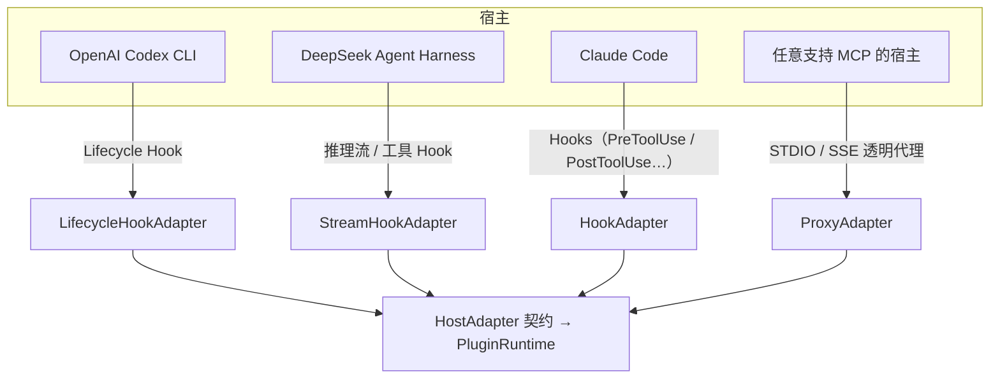

# 具体插件 `plugins/*`

具体插件是「核心关键实现」的落地点。每个插件只负责一个宿主，面向 `plugin-kit` 编程，不包含检测或规划算法。

## 接入拓扑

四种宿主 × 四种适配方式，最终都收敛到同一个 `HostAdapter` 契约：



## 模块职责

针对单一宿主实现 `HostAdapter` 三件事：

1. **subscribe** — 监听宿主生命周期事件（推理、工具调用、命令执行）
2. **normalize** — 把宿主原生事件序列化为 `ExecutionContext`
3. **materialize** — 把 `SteeringEffect` 列表按序变成宿主动作（注入提示、改写参数、重定向工具、挂起审批）

## 插件清单

| 插件 | 包名 | 宿主 | 适配方式 | 承接的纠偏等级 |
|---|---|---|---|---|
| codex | `@chaos-design/arcs-plugin-codex` | OpenAI Codex CLI | Lifecycle Hook | L1–L4 |
| deepseek | `@chaos-design/arcs-plugin-deepseek` | DeepSeek Agent Harness | 推理流 / 工具 Hook | L1–L4 |
| claude-code | `@chaos-design/arcs-plugin-claude-code` | Claude Code | Hooks（PreToolUse / PostToolUse） | L1–L4 |
| mcp | `@chaos-design/arcs-plugin-mcp` | 所有支持 MCP 的宿主 | 透明代理网关 (STDIO/SSE) | L1–L3 |

> **MCP 插件为何只支持 L1–L3**：透明代理模式只见协议流量、不进入宿主进程，没有可用的审批回调通道（无法把 `Suspend` 挂起结果送回宿主执行流）。L4 高危越权需要宿主侧插件（或宿主自身的确认机制）承接，代理层只能做到阻断 + 注入提示（按拒绝语义处理）。

### MCP 代理落地语义（已实现，STDIO 行分隔 JSON-RPC）

| 效果 | 代理落地动作 |
|---|---|
| `PassThrough` | 原样转发下游 |
| `PatchArgs`（L1） | 改写 `arguments` 后转发（patch 为修复后的完整参数） |
| `RedirectTool`（L3） | 改写 `tools/call` 目标工具后转发（原调用被阻断） |
| `InjectMessage`（L2） | 不转发下游，合成 `isError: true` 工具结果（虚拟报错） |
| `Suspend`（L4） | 不转发下游，合成阻断提示结果（拒绝语义，无审批通道） |

> 决策规则：一次调用的效果列表中若存在转发（含改道），以最后一个转发为准——L3 的注入在改道后没有结果通道，跳过；否则取最后一个合成响应。拦截按串行队列处理，保证与请求顺序一致。

配置方式（透明代理挂载，与 README 快速开始一致）：

```bash
npx @chaos-design/arcs-plugin-mcp \
  --goal "仅修复前端样式 Bug，禁止修改后端 API 路由" \
  --target "npx -y @modelcontextprotocol/server-filesystem ./src" \
  [--drift-threshold 0.75] [--max-consecutive-loops 2] [--protected-paths ".env*,**/migrations/**"]
```

## 核心抽象

- `codex: LifecycleHookAdapter` — 挂载 Codex 生命周期钩子
- `deepseek: StreamHookAdapter` — 拦截推理流与工具纠偏
- `claude-code: HookAdapter` — 基于 Claude Code Hooks（PreToolUse / PostToolUse 等）拦截工具调用与推理
- `mcp: ProxyAdapter` — 代理下游 MCP Server 流量

## 依赖关系与交互

- **依赖**：`plugin-kit`（`HostAdapter`、`PluginRuntime`、桥接）+ 宿主自身 SDK/协议。
- **不依赖**：core 的具体算法（由运行时间接调用）。
- **交互**：事件流从宿主流入 → 胶水层归一 → core 决策 → 胶水层物化 → 动作返回宿主，任务全程不中断。

## 配置示例

```json
{
  "plugins": [
    {
      "name": "@chaos-design/arcs-plugin-codex",
      "enabled": true,
      "options": {
        "driftThreshold": 0.72,
        "autoBreakLoops": true,
        "protectedPaths": ["migrations/**", ".env*"],
        "steeringMode": "inject-hint"
      }
    }
  ]
}
```

新增宿主插件的步骤见 [extension-points.md](./extension-points.md)。
