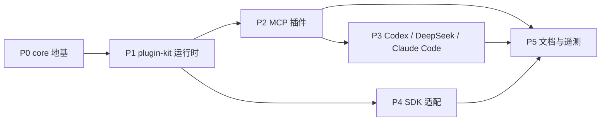

# 后续落地计划

| 阶段 | 目标 | 关键交付 | 完成标准（DoD） | 状态 |
|---|---|---|---|---|
| **P0** | core 地基 | 模型、接口、纯检测算法 | 类型检查通过；核心算法单测覆盖；**失败降级策略单测通过**（传感器跳过 / 整体 PassThrough+degraded）；依赖扫描确认零宿主依赖 | ✅ 2026-11-17 |
| **P1** | plugin-kit 运行时 | `HostAdapter`、`PluginRuntime`、SessionState、Config/HITL/Telemetry 桥接 | **ReplayHarness 回放仿真通过**（效果列表顺序、预算、degraded、HITL 三分支）；mock adapter 跑通 capture→sense→plan→apply 全链单测 | ✅ 2026-11-17 |
| **P2** | 首个插件（MCP） | `plugins/mcp` 端到端 | 真实 MCP Server 挂载，L1/L2 纠偏可观测，审计事件可查询 | ✅ 2026-11-17 |
| **P3** | 全平台宿主插件（8 家） | codex / deepseek / claude-code / zcode / workbuddy / opencode / pi / trae 的 `HostAdapter` + host-kit 共用运行时 | 契约护栏（`verify:contracts`）与 mock 宿主/子进程夹具全绿；**真实宿主进程实测由集成方执行**（`scripts/host-real-check.mjs`） | ✅ 2026-11-17（真实宿主实测待集成方） |
| **P4** | SDK 适配 | `sdk/vercel`、`sdk/langchain` | 各自 demo 跑通，`SteerEvent` 字段正确，边界约束通过 review | ✅ 2026-11-17（doStream 透传为 v1 裁剪，见 docs/sdk.md） |
| **P5** | 文档与遥测 | 架构文档、Mermaid 图、偏移曲线面板 | README 与 docs 同步完成；图均可渲染；偏移曲线可从 JSONL 聚合并可视化（`pnpm dashboard`，终端 + `--html`） | ✅ 2026-11-18 |

## 阶段依赖

## 实施原则

- 每阶段完成并验证后再进入下一阶段，不批量堆积未完成项。
- 决策超出代码范围（产品/安全/发布/平台）时，记录为待决事项，不臆断推进。
- 文档随实现同步更新，README 保持与 docs 一致。
- 测试分层与各阶段 DoD 的对应关系见 [testing.md](./testing.md)；每个计划用仓库 `plans/` 目录的 plan-flow 流程管理（状态与优先级契约见 `plans/README.md`）。
