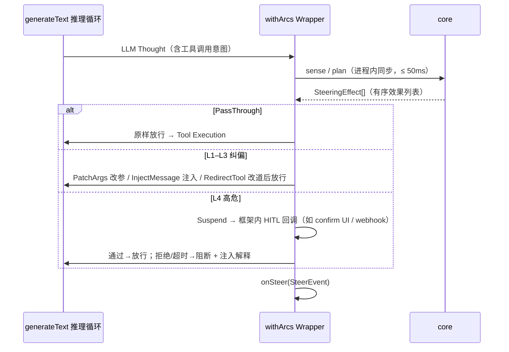

# SDK 代码级接入 `sdk/*`

SDK 面向自研 Agent 应用，采用 `sdk/xxx` 独立文件夹形式。它把 core 的检测与决策包装成框架原生可插拔件，直接依赖 core，不经过胶水层。

## 拦截点

SDK 在框架推理循环的 `LLM Thought → Tool Execution` 之间做进程内同步拦截，等价于把 core 的 `sense → plan` 挂进调用链：



## 职责

- 提供 Middleware / Model Wrapper / Node / Callback 等框架原生接入件
- 在 `LLM Thought → Tool Execution` 之间无侵入捕获执行快照（`withArcs`）
- 把 core 输出的有序 `SteeringEffect` 列表翻译为框架内的控制流（继续、改参、注入消息）
- 通过 `SteerEvent` 向宿主应用暴露操舵可观测性

## SteerEvent 契约

`onSteer` 回调收到的是结构化事件，而非字符串日志：

```typescript
interface SteerEvent {
  level: 1 | 2 | 3 | 4;         // 触发的纠偏等级
  effects: SteeringEffect[];    // 实际物化的有序效果列表
  signals: DriftSignal[];       // 触发信号
  latencyMs: number;            // sense + plan 耗时
  reason: string;               // 人类可读的介入原因
}
```

## 边界（与 plugins 的分工）

| 维度 | SDK (`sdk/*`) | 插件 (`plugins/*`) |
|---|---|---|
| 运行环境 | 进程内 | 进程外宿主 |
| 依赖路径 | 直接依赖 core | 经 plugin-kit 依赖 core |
| 接入形态 | Middleware / Wrapper / Node | Lifecycle Hook / STDIO+SSE 代理 |
| 生命周期接管 | 不接管 | 可接管宿主 Hook |
| 流量代理 | 不做 | MCP 插件做协议流量代理 |
| 类型约束 | 强类型、同步可组合 | 事件驱动、协议耦合 |

**边界红线**：`sdk/*` 不得实现生命周期 Hook 或流量代理，避免与插件职责重叠。

## 目录

```text
sdk/
├── vercel/      # @chaos-design/arcs-sdk-vercel — withArcs 模型包装器（LanguageModelV4）
├── langchain/   # @chaos-design/arcs-sdk-langchain — createArcsNode（LangGraph 兼容节点，零框架依赖）
└── README.md    # SDK 职责与边界总览
```

## 使用示例

```typescript
import { generateText } from 'ai';
import { openai } from '@ai-sdk/openai';
import { withArcs } from '@chaos-design/arcs-sdk-vercel';

const steeredModel = withArcs(openai('gpt-4o'), {
  goal: '重构 src/auth 目录下的鉴权逻辑，严禁修改数据库迁移文件',
  policy: {
    driftThreshold: 0.75,
    maxConsecutiveLoops: 2,
    enablePatchArgs: true,     // 开启工具参数自动热修复（L1）
  },
  onSteer: (event: SteerEvent) => {
    console.warn(
      `[ARCS 操舵介入] L${event.level} | ${event.reason} | 效果: ${event.effects.map(e => e.type).join(' → ')}`
    );
  },
  hitl: async ({ toolName, reason }) => confirm(`允许 ${toolName}？${reason}`), // L4 进程内审批
});

const { text } = await generateText({
  model: steeredModel,
  tools: myCodingTools,
  prompt: '开始重构鉴权模块',
});
```

### LangGraph 节点用法（sdk/langchain）

```typescript
import { createArcsNode } from '@chaos-design/arcs-sdk-langchain';

graph.addNode('arcs', createArcsNode({ goal: '仅修复前端样式 Bug' }));
// 节点输入：{ goal, thought, toolCall, history }；输出：{ toolCall（改写/null）, inject?, steer? }
```

### 已知范围裁剪（v1）

- `withArcs` 拦截 `doGenerate`（generateText / Agent 循环）；`doStream` **透传不纠偏**——`streamText` 场景需后续版本补齐。
- `InjectMessage` 在 SDK 语境下翻译为「tool-call → text 替代」：框架内无消息注入通道，阻断提示以模型输出形式呈现。
- langchain 的 `createArcsNode` 为零依赖结构实现（LangGraph 节点即普通函数）；`CallbackHandler` 形态待后续补充。
