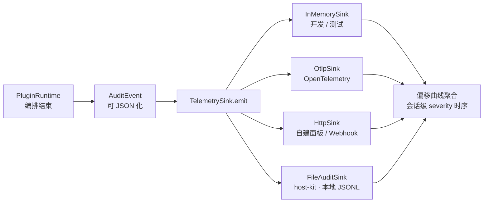

# 遥测 `packages/telemetry`

## 包定位

数据模型与接收端契约包：定义 `AuditEvent` 与 `TelemetrySink`，不参与决策、不感知宿主。

- **依赖方向**：`plugins → plugin-kit → telemetry → core` 单链；telemetry 仅依赖 core（消费 `DriftSignal` / `SteeringEffect` 等产出类型）。
- **被依赖**：胶水层在每次编排结束后 emit 审计事件；`sdk/*` 可按需直接依赖 telemetry 上报。

## AuditEvent 模型

```typescript
interface AuditEvent {
  ts: number;
  sessionId: string;
  host: string;                   // codex / deepseek / claude-code / mcp / sdk-vercel / sdk-langchain
  level: 1 | 2 | 3 | 4 | null;    // 触发等级，null = 无偏航放行
  signals: DriftSignal[];
  effects: SteeringEffect[];      // 实际物化的有序效果列表
  latencyMs: number;              // normalize + sense + plan 耗时
  degraded: boolean;              // fail-open 降级标记（见 constraints.md #7）
  hitl?: { approved: boolean; timeout: boolean };   // 仅 L4 存在
}
```

## 审计事件流



## TelemetrySink 契约

```typescript
interface TelemetrySink {
  emit(e: AuditEvent): void;
}
```

实现要求（扩展时必须遵守，详见 [extension-points.md](./extension-points.md)）：

- `emit` **不得抛出异常**——遥测失败静默丢弃，绝不影响纠偏主链；
- 同步实现须 < 1ms，否则改为内部缓冲 + 异步冲刷；
- 不做阻塞 I/O，不反压宿主。

### FileAuditSink（本地持久化，位于 `packages/host-kit`）

为使"真实宿主联调"可验证，`host-kit` 提供 `FileAuditSink`（实现 `TelemetrySink`），保持 telemetry 包零 I/O 的纯逻辑边界：

- 路径：`ARCS_AUDIT_FILE` 指定精确文件；否则 `<ARCS_HOME>/audit/<host>/<YYYY-MM-DD>.jsonl`（`ARCS_HOME` 默认 `~/.arcs`）
- 写入：`appendFileSync` 单次写完一整行；失败静默（遥测不得阻塞主链）
- 内容：只含 `AuditEvent` 已校验的结构化字段，**不含原始 prompt 与工具参数**；`evidence` 可能含路径信息，按需管理文件权限
- 装配：`runHookEntry`、三个订阅型插件（opencode/pi/deepseek）与 `arcs-plugin-mcp` CLI 默认按环境变量构造 sink；未设置任何变量时不创建，行为与旧版完全一致

验证一次真实会话：

```bash
export ARCS_HOME=~/.arcs
# 用自有账号启动一次真实 Agent 会话并触发工具调用
node scripts/host-real-check.mjs --verify   # 报告事件数、按宿主/等级统计、降级次数
```

## 偏移曲线（Steering Arc 曲线）

遥测的核心分析产物：按 `sessionId` 聚合 `DriftSignal.severity` 随事件序的变化曲线，用于回答两个问题——

1. **是否收敛**：纠偏介入后 severity 是否单调下降、偏航间隔是否拉长；
2. **是否过舵**：PassThrough 占比、`PatchArgs` 命中率、HITL 误报率。

输出为 JSONL（每行一个 `AuditEvent`），供可视化面板与回放仿真（[testing.md](./testing.md)）消费。

### 偏移曲线面板（roadmap P5，已实现）

仓库内置零依赖面板脚本（`scripts/offset-dashboard.mjs`，即 `pnpm dashboard`）：

```bash
corepack pnpm dashboard                                    # 读 $ARCS_HOME/audit/**/*.jsonl，终端统计 + 每会话 sparkline
corepack pnpm dashboard --file audit.jsonl --html panel.html   # 生成独立 HTML 面板（内联 SVG，零外部资源，浏览器直接打开）
corepack pnpm dashboard --session demo- --limit 5          # 会话前缀过滤 / 展示条数
```

- 聚合语义与渲染分离：数据模型由 `@chaos-design/arcs-telemetry` 的 `buildDashboardModel`（纯函数）产出——等级直方图、HITL 三分支（批准/拒绝/超时互斥）、放行占比、按会话收敛判定（尾 3 点均值 < 首 3 点均值）；
- 面板回答两个问题：**是否收敛**（severity 曲线尾段下移）与**是否过舵**（放行占比过高=漏检，PatchArgs 命中率与 HITL 误报）；
- 自建面板/OTLP 消费方可直接复用 `buildDashboardModel`，渲染层可替换（扩展点见 [extension-points.md](./extension-points.md)）。
