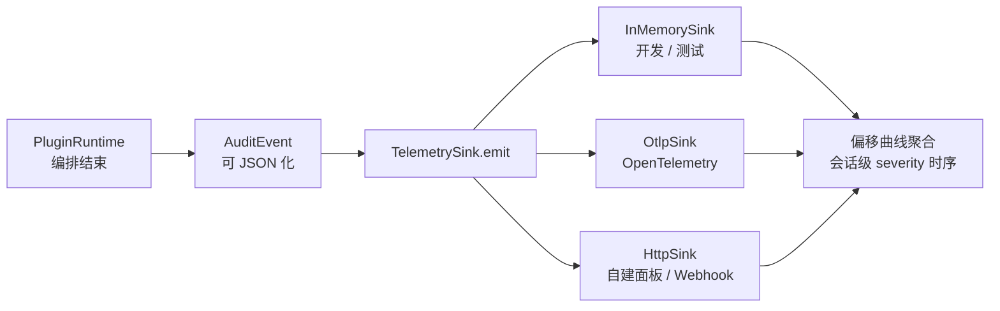

# 遥测 `packages/telemetry`

## 包定位

数据模型与接收端契约包：定义 `AuditEvent` 与 `TelemetrySink`，不参与决策、不感知宿主。

- **依赖方向**：`plugins → plugin-kit → telemetry → core` 单链；telemetry 仅依赖 core（消费 `DriftSignal` / `SteeringEffect` 等产出类型）。
- **被依赖**：胶水层在每次编排结束后 emit 审计事件；`sdk/*` 可按需直接依赖 telemetry 上报。

## AuditEvent 模型

```typescript
interface AuditEvent {
  ts: number;
  sessionId: string;
  host: string;                   // codex / deepseek / claude-code / mcp / sdk-vercel / sdk-langchain
  level: 1 | 2 | 3 | 4 | null;    // 触发等级，null = 无偏航放行
  signals: DriftSignal[];
  effects: SteeringEffect[];      // 实际物化的有序效果列表
  latencyMs: number;              // normalize + sense + plan 耗时
  degraded: boolean;              // fail-open 降级标记（见 constraints.md #7）
  hitl?: { approved: boolean; timeout: boolean };   // 仅 L4 存在
}
```

## 审计事件流



## TelemetrySink 契约

```typescript
interface TelemetrySink {
  emit(e: AuditEvent): void;
}
```

实现要求（扩展时必须遵守，详见 [extension-points.md](./extension-points.md)）：

- `emit` **不得抛出异常**——遥测失败静默丢弃，绝不影响纠偏主链；
- 同步实现须 < 1ms，否则改为内部缓冲 + 异步冲刷；
- 不做阻塞 I/O，不反压宿主。

## 偏移曲线（Steering Arc 曲线）

遥测的核心分析产物：按 `sessionId` 聚合 `DriftSignal.severity` 随事件序的变化曲线，用于回答两个问题——

1. **是否收敛**：纠偏介入后 severity 是否单调下降、偏航间隔是否拉长；
2. **是否过舵**：PassThrough 占比、`PatchArgs` 命中率、HITL 误报率。

输出为 JSONL（每行一个 `AuditEvent`），供 roadmap P5 的可视化面板与回放仿真（[testing.md](./testing.md)）消费。
